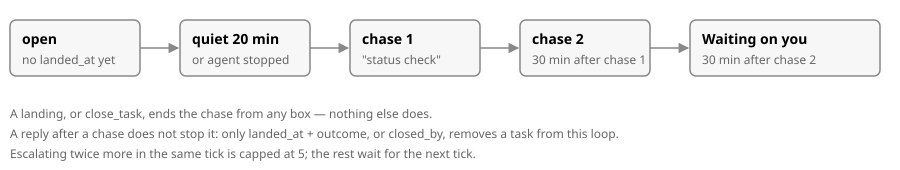

# The task loop

Nobody has to remember to land a task. [`TaskLoop.js`](../TaskLoop.js) checks every open task on a
timer, wakes its agent when it has gone quiet, and — if that gets no landing — puts the task where
the owner will see it. Design: [`skills-as-a-workflow-tasks-chased-by-nod`](/framework/ai/sessions/2026/09/28/cards/skills-as-a-workflow-tasks-chased-by-nod/design.md).
Interfaces it agreed with its siblings: [`interfaces.md`](/framework/ai/sessions/2026/09/28/task-loop/task-loop/interfaces.md).

## The timers

| variable | default | what it does |
|---|---|---|
| `SERVEX_TASKLOOP_EVERY_MIN` | 5 | how often the loop looks at every open task |
| `SERVEX_TASKLOOP_QUIET_MIN` | 5 | a started task's log has had no new line this long: it gets a status ask, and another this often while silent |
| `SERVEX_TASKLOOP_FOLLOWUP_MIN` | 120 | a task in the `waiting` state on the owner gets one reminder after this long, then one a day; only `running` tasks are chased (state from [core/Task](../../public/framework/core/Task/readme.md) `Task.replay`) |
| `SERVEX_NO_TASKLOOP` | unset | set to `1` to stop the ticking; `close_task` and `task_loop_status` still work |

A task is **open** when its `task.jsonl` has no `landed_at` carrying a non-empty `outcome`, and no
`closed_by`. The loop reads today's and yesterday's task dirs under `public/framework/ai/`,
starting from Servex's own repo root — a worktree's Servex chases the worktree's own tasks, never
the live site's.

A step overdue past 2x its estimate gets one nudge too, independent of the chase: [steps.md](steps.md) (the Step runner).

## Chase

Every **started** (`running`) task is chased: no opt-in, no date gate. Accepted (idle), proposed (waiting), paused, stopped and complete tasks are left alone.

A started task whose log has had no new line for 5 minutes gets ONE message to its agent: the task title and path, *"no line on your log for N min. Add a line with where you are, or complete or stop it."* An agent that is not live is woken the usual way (`agents.send`), unless it was stopped on purpose; and if Heartbeat already has a status check out for that agent, TaskLoop waits. Another ask every 5 minutes while it stays silent. Each ask is a `{"log": {"msg", "ask": n}}` line on the task's own log.

After **three asks in a row with no new line** (the third sat unanswered), or when the agent's last line says it is blocked (a `blocked` key, or a log message starting "blocked"): one red flag, the card TaskLoop already used (`card_ask`, else a plain card message, else the Inbox), logged as `{"log": {"flag": n}}`. After that, one more flag per hour while it stays silent. **Any new line that is not ours resets the count.** The counts are those `ask`/`flag` lines, so a restart loses nothing. At most 5 flags happen in one tick. Code: `TaskLoop.chase()`; test: `Servex/TaskLoop-chase.test.mjs` (fake clock). Model: [core/Task resolution.md](../../public/framework/core/Task/doc/resolution.md) section 8.

## Inboxes and waiting on others (cracks rows 1 and 5, 2026-10-23)

- **Every inbox is read.** Each tick `TaskLoop.read_inboxes()` looks at the `inbox.jsonl` beside every task log of the last 30 days. "Read" is the mark `Heartbeat.inbox()` already uses: a `{read_upto, at, by}` line appended to the inbox itself; unread lines are the ones with `text` after the last mark. A live owning agent gets all its unread lines as ONE message, then the mark. A stopped or gone agent keeps them unread and the inbox makes ONE card (an `{inbox_card:{upto}}` line stops a second one until new lines arrive). A line older than 7 days is marked read with a `note` and never delivered.
- **Waiting on an agent or a task path.** `TaskLoop.remind_other()`: after `SERVEX_TASKLOOP_FOLLOWUP_MIN`, and again each interval, the agent waited on (an agent id, or the owning agent of a task path) is told "Task x is waiting on you for <what>" (a `follow_up` line). After 3 reminders with no change, ONE flag card (`follow_up` with `flag:true`).
- Test: `node Servex/TaskLoop-cracks.test.mjs` (temp store, fake clock).

## Dropped work (completion, 2026-10-25)

Each tick, before the chase, `Dropped.tick()` ([Servex/Dropped.js](/Servex/Dropped.js)) finds every open task whose owner is not working (stopped, dormant, gone, never assigned; or a deferral with no home or past its time), writes ONE `{log:{dropped,reason}}` line into the parent's log, and rewrites `queue/dropped.json` for the queue page. Those lines are not activity: `read_task` skips them. `status()` carries the `dropped` count. Rules and codes: [core/Task completion.md](../../public/framework/core/Task/doc/completion.md). Test: `node Servex/Dropped.test.mjs`.

## Close

A task can leave the loop two ways: it completes or stops, or the owner
closes it without landing. `close_task({dir, why})` is that second door — it appends
`{"assign": {"closed_by": "owner", "closed_at", "closed_why"}}` to the task's own log, the only
other line that stops the chase for good. `task_loop_status()` answers `{open, quiet, chased,
escalated, last_tick}` — the last two are how many this Servex process has done since it started;
the file itself, not memory, is what survives a restart.

## The heartbeat

The task loop looks every few minutes at every open task; the heartbeat
([`Heartbeat.js`](../Heartbeat.js)) watches the *agent* that owns each one, from the events it
already emits (a message, a tool call, a turn ending), with a one-minute tick as the backstop. It is
plain node over `agents.watch` and `agents.send`, so any harness can feed it. The rules:

- **Who is watched:** the agent on line 1 of an open task's `task.jsonl`, only for tasks opened after `SERVEX_HEARTBEAT_SINCE` (or whose line 1 says `heartbeat: true`), so a restart never wakes old tasks.
- **Silent 5 minutes** (`SERVEX_HEARTBEAT_SILENT_MIN`) → the neutral status check, queued behind its turn, never while a tool is running. Once per silence; each answered check doubles the wait before the next.
- **It answers** → the answer goes on the task's card, and nothing else happens.
- **No answer in 5 more minutes, or its agent stopped, failed or is gone** → triage: queued at the spawn gate (say so), paused or stopped on purpose (say who stopped it; never revived), otherwise revive it from its session id, with its unread `inbox.jsonl` in the prompt.
- **Revives are rationed:** at most 2 per task per hour and 5 per day, through the spawn gate, one every 30 s, from a queue kept in a file (`heartbeat-queue.json`) that survives a restart.
- **Escalate only when the fix fails:** the revive threw, the ration is spent, or a tool has run for 3x the silence. That goes on the card (`card_ask` when registered, else a card message) and the heartbeat stops chasing that task.
- **A minion stuck at the spawn gate** for 5 minutes, or dropped from its queue without starting, wakes its parent once, naming the minion, the wait and the gate's reason.
- **A child's result is never lost:** `wake_parent` revives a stopped parent through the host's `send()`, and also appends the result to the parent task's `inbox.jsonl`.
- Every check, answer, revive and escalation is one `{"log": {"heartbeat": …, "msg"}}` line in the task's own log. `heartbeat_status` lists who is being watched and how long each has been silent; `SERVEX_NO_HEARTBEAT=1` turns it off.
- **A post with no card to reach falls back to the owner's Inbox** (2026-10-01): a task with no card named, or a named card that answers "no card", used to just go nowhere — logged, but never shown anywhere a person would look. `Heartbeat.post()` now drops the same note on the task's own page via `agents/inbox.js`: [`never-lose-a-wake.md`](./never-lose-a-wake.md).
- **A card named by title resolves** (2026-10-18): `Heartbeat.post()` looks the task's `card` up with `Cards.by_name()` (id or slug, else exact title); a name that is neither an id nor a title logs one line naming the task and posts nothing. Test: `node Servex/Heartbeat-card.test.mjs`.

**Done (2026-10-17): the heartbeat never wakes a landed agent.** A helper that ended its work with a `{"finish":{…}}` or `{"complete":{…}}` line (the task system's own verbs) was "not landed" to `task_landed()`, which only knew `landed_at` plus an outcome, so the status check, the landing nag and the compact nudge woke it every few minutes all day; each wake re-read a 70–110k context (`helper-bubbles-anchor` $72.68, `sheet-double-mount` $62.20, `sheet-handoff-proof` $51.56, `dictate-wide` $39.39, `readme-trim` $21.46, `layout-check-path` $20.24, against $3–4 budgets; `helper-compact-nudge` $194.95 over 40 turns). Now:

- **One rule.** [`Landed.js`](../Landed.js) folds the log through `Task.replay`; `complete` or `stopped` is landed (the old `landed_at` + outcome answer survives only as the fallback if replay throws). `task_landed()`, `Heartbeat.read`, `Budget`, `Worktrees`, `Lifecycle`, `Asks`, `asks/tasks.js` and `Cards` all ask it. [one-state.md](/framework/ai/doc/one-state.md).
- **No watchdog wake.** `Agent.send` refuses `servex-heartbeat` and `servex-compact-nudge` messages for an agent whose task has landed, and logs `heartbeat: skipped, landed` once (the heartbeat writes it once to the task's log; the agent logs one `heartbeat-skipped` event per reason). A person's message, `wake_parent` and `revive: true` are unchanged. A landed agent that ends a turn sleeps (`dormant`).
- **A log that says complete but whose branch is not on michael/dev gets no status check either** (2026-10-28): `Landed.of_file` counts that as not landed, so the heartbeat used to ping the agent every hour while the branch waited for review. `Heartbeat.tick` now skips the check and logs one `heartbeat: refused` line; the merge nag (`Agent.landing_check`) and a revive of a dead agent are unchanged. Test: `Servex/Heartbeat-landed.test.mjs`.
- **Spend.** A watchdog wake is refused when `spent + the last turn's cost` would pass the brief's `Budget: $N` (else `ceiling_usd()`): a $4 helper at $0.70 a wake is woken five times and refused the sixth. The agent's own work is still not capped (budgets stay advisory, 2026-10-08).
- Test: `node Servex/Heartbeat-landed.test.mjs`.

## Worktree servers

A task built in its own worktree (`Server/worktree-up.mjs`) also has its own private dev server,
and on 09-28 nothing ever took one down: 24 pairs (about 2.1 GB) were still running for tasks that
had landed days before. `landed_at` alone isn't proof it's safe, though — the same day,
collab-rounds had a `landed_at` while its branch wasn't merged and its minion was still fixing a
bug, and something stopped its server on that one signal anyway. So
[`Server/worktree-sweep.mjs`](../../Server/worktree-sweep.mjs)'s `can_stop(entry)` checks all
three before anything is stopped: the worktree's own task (found by its task.jsonl line 1
`worktree` field) has `landed_at` **and** a real `outcome`; its branch is fully merged into
`michael/dev` (`git merge-base --is-ancestor`); and no live agent is still working there — the
task's own mastermind, one of its minions, or any agent whose recorded `cwd` sits inside the
worktree. All three true and it calls `Server/worktree-down.mjs`, which already refuses to remove
a dirty tree.

Two things call it: `Server/on-landing.mjs` runs `can_stop` for the task's own worktree the moment
it lands — stops it if that's ok, else posts one line on the task's card naming why, with any
untracked files named too, since those may be work that never merged. And this loop's own `tick()`
runs `sweep()` once a tick, in a hidden child process: it walks every worktree Servex knows about
(`.worktrees.json`) and stops any whose directory is simply gone, or whose `can_stop` now reads ok
— a safety net for whatever `on-landing.mjs` missed (Servex was down, or an agent was still
working at landing time and has since finished). Neither one ever touches the main tree's server
or Servex's own — those are never in that registry. `node Server/worktree-sweep.mjs --dry` prints
what a real run would do without stopping anything.

**Done (2026-10-13): `TaskLoop.follow_up_daily()`** runs inside the existing 5-minute tick (no second scheduler). Once per local day (follow-up.md's mtime is not today) it runs `node Server/FollowUp.mjs --write`, posts one `owner_note` row "Follow-up <day>: N flagged" to the Inbox, and `LogSweeper.ALLOW` commits `follow-up.md` and `follow-up-full.md` on its next sweep. Page: [follow-up](/framework/ai/doc/follow-up.md). Also fixed: `FollowUp.read_asks` keys by `card || title`, so an empty `card` no longer merges asks.

**Done (2026-10-17): `TaskLoop.handover_daily()`** sits beside `follow_up_daily()` in the same tick. Once per UTC day (the date in the NOW block's own `## NOW (computed <date>` stamp in `handover.md` is not today; the file's mtime would not do, since people edit it too) it runs `node Server/HandoverNow.mjs --write`, which rewrites only the computed block. `LogSweeper.ALLOW` commits `handover.md` on its next sweep. A failure is logged as `task-loop-error`. Test: `node Servex/TaskLoop-handover.test.mjs`.

**Done (2026-10-17): `TaskLoop.undone_asks_daily()`** sits beside them. Once per UTC day (the `generated_at` in `ai/asks/undone.json` is not today) it runs `node Server/UndoneAsks.mjs --json`; `LogSweeper.ALLOW` commits `undone.json`. Page: [undone asks](/framework/ai/asks/undone/). `needs_restart`: Servex must restart to pick it up.
