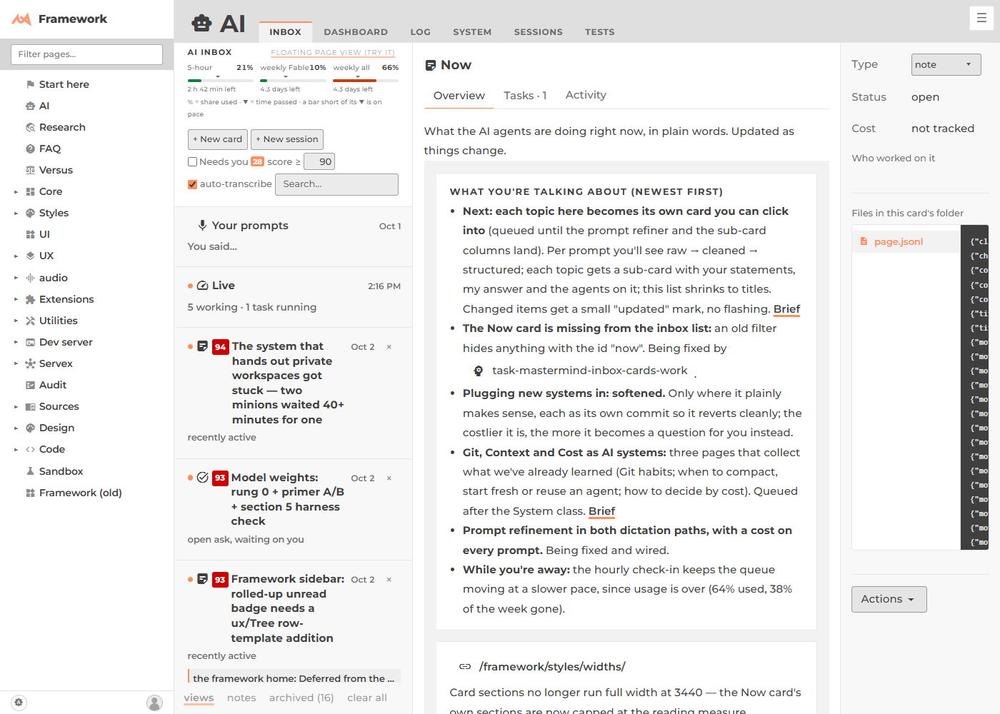

# Why the AI pages flashed unstyled on reload

**Cause: the card-class dynamic import** — not `page.jsonl` replay, not the live-reload CSS swap.

`Router.load()` awaited `app.styles_loaded()` **before** `page.chain()`'s own `.loading`.

The chain's `.loading` is what imports every pending child module (a day page's task
cards, an `ai2` `RealPage`'s embedded page). Importing a module is what runs its
`View.stylesheet()` call, pushing a new promise onto `View.stylesheets`.

`styles_loaded()` only awaits whatever is in that array **at the moment it's called**.
So awaiting it before the chain finished missed any stylesheet a child registered only
once its own import landed — `activate()` painted that child before its CSS arrived.

Ruled out:
- **Live-reload CSS swap** — tested with a 400ms-throttled stylesheet fetch. Chromium
  keeps the old `<link>`'s rules applied until the new resource loads; no FOUC.
- **`page.jsonl` replay** (`AITask.refresh()`) — only touches already-imported modules,
  no new CSS ever enters the picture.

## The fix

One swap in `public/framework/core/Router/Router.js` `load()`: await the chain's
`.loading` first (so any newly-imported child registers its stylesheet), then
`app.styles_loaded()` second (so it catches what just got registered). Both awaits stay
`allSettled`, so a broken child or a 404'd stylesheet still can't block navigation.

Documented inline at the call site and in
`public/framework/core/Router/doc/styles-loaded.md`.

## Proof

Reload of `/framework/ai/2026/10/03/now/` after the fix — fully styled, no raw text:

