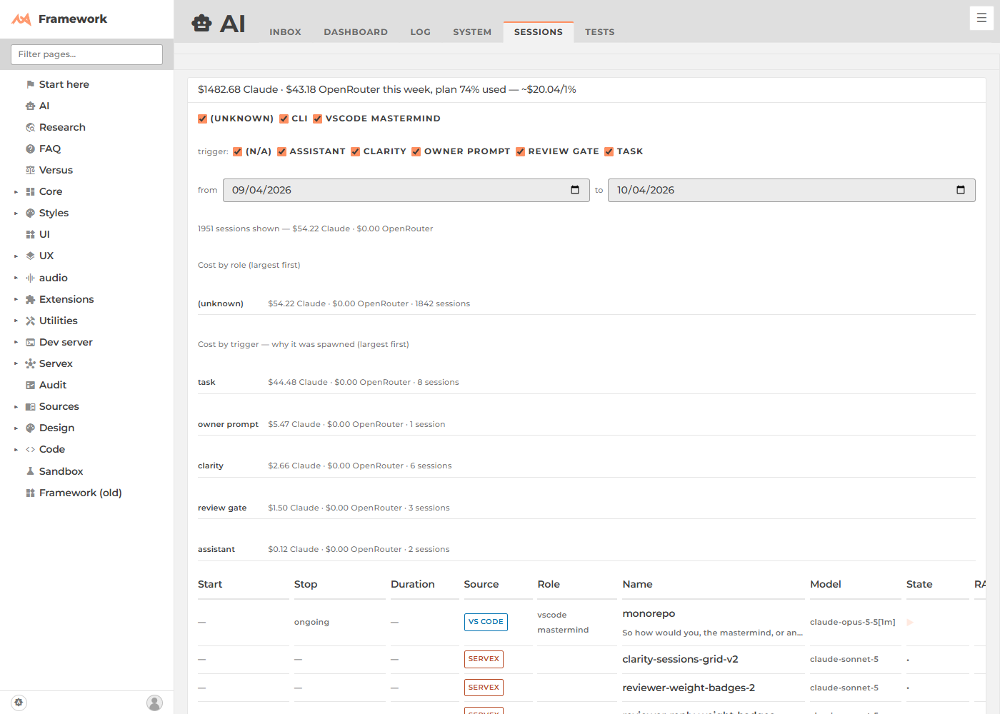

# Study: what reviews and clarity checks actually cost, and whether they pay off

Computed by [`Server/spend-tree.mjs`](/code/) from the registry + every agent's own log, and
from every `review` verdict logged across `ai/` — nothing here is estimated by hand (law 7).
As of 2026-10-04 04:44 UTC; re-run `node Server/spend-tree.mjs` to refresh. The live, clickable
version is the [Sessions tab](/framework/ai/sessions/) — filter by "trigger" there.

## The headline

**Reviews find something real 87% of the time. Clarity checks cost little and aren't measured
the same way yet. Neither is the place to cut.**

| Trigger (own $, not what it spawned) | Since Oct 1 | Share |
|---|---|---|
| task (the actual work) | $1,223.68 | 70.4% |
| owner prompt (started directly by the owner) | $274.64 | 15.8% |
| clarity (the landed-work spot-check) | $113.50 | 6.5% |
| review gate (fresh eyes before a merge) | $93.12 | 5.4% |
| assistant / echo / dispatcher | $32.40 | 1.9% |
| **Total since Oct 1** | **$1,737.34**, 572 agents | |

Review + clarity together: **$206.62, about 1 in 8 dollars since Oct 1.** The owner's own
estimate was "$1,408 across 566 agents" — close, not identical; the gap is almost certainly
agents spawned since that estimate, not a different method.

## Does a review pay for itself?

Every `review.mjs` run logs `pass` or `fix` (it found something and the task changed). Read
straight from `task.jsonl`, split by size:

| Review size | Passed clean | Found a fix | Fix rate |
|---|---|---|---|
| full | 14 | 133 | **90%** |
| light | 10 | 24 | **71%** |
| **all** | 24 | 157 | **87%** |

That's the opposite of a rubber stamp — nine times in ten a `full` review catches something
real. The owner's worry ("doubling token consumption for a second green check") is the risk
for a review that reliably passes clean; most don't.

Separately, 17 tasks already skip review entirely (`--size none --why`) — the escape hatch
this study would otherwise recommend building already exists and is in use.

**Recommendation: keep review gated by the computed size, change nothing.** `full` is almost
never wasted; `none` already catches the truly trivial. To spend less, tighten which tasks
get `full` vs `light`, not how hard each review looks once assigned.

## Clarity: cheap, not measured the same way yet

375 clarity agents, $193.72 all-time, **$0.52 avg** — far cheaper than a review. But unlike
`review.mjs`, a clarity check writes no structured verdict, only free text in its own
transcript, so this script can't tally "found something" vs "clear" the reliable way it just
did for reviews.

**Recommendation: have clarity log one structured line per check**
(`{"clarity":{"verdict":"clear"|"flagged"}}`, same place `review` already logs), so the next
run of this study can give clarity the same real fix-rate table.

## Where the tree lives

- The whole tree, every agent, nested: [`Server/spend-tree.mjs`](/code/) → gitignored
  `spend-tree.json` (same rule `sessions.json`/`week.json` already follow).
- Browse it, click parent → children, filter by trigger: the
  [Sessions tab](/framework/ai/sessions/) (screenshot below).
- Per-task totals by module/day are a separate, already-built tool — see
  @task-mastermind-day-overview; this study doesn't repeat it.
- What "trigger" means, and where it's a guess:
  [`sessions/doc/cost/spend-tree.md`](/framework/ai/sessions/doc/cost/spend-tree.md).

