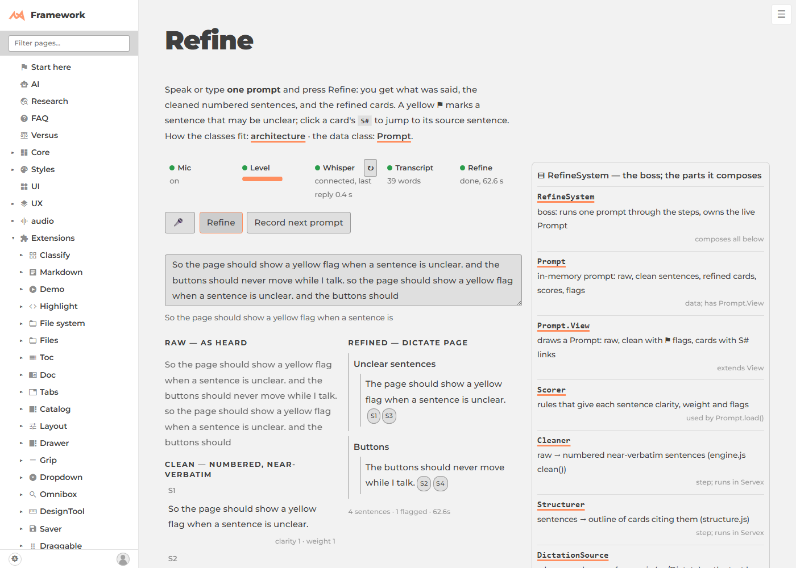
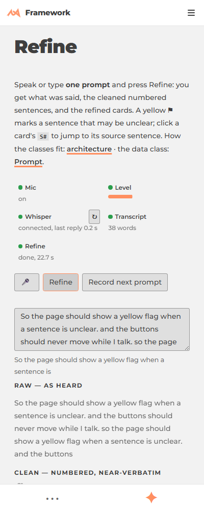

# Refine: dictation fixed, controls still, a visible connection (2026-10-09)

- [x] **One widget:** Refine uses `ux/Dictate`, the same engine the voice chat wraps in `Widget`. Nothing was deleted.
- [x] **Buttons never move:** fixed toolbar row; headless run measured 0 position changes while words arrived (1400 and 400).
- [x] **Plain status words:** the Mic / Whisper line reads "Mic: on, level ok · Whisper: connected, last reply 0.3 s".
- [x] **Whisper diagnosis:** [whisper-flow-2026-10-09](/framework/ext/Refine/md/doc/whisper-flow-2026-10-09/): 0 of about 145 requests failed. The real error was a page bug (`$input` was the element, not the View), fixed. Recommendation: keep local Whisper.
- [x] **Connection row:** Mic, Level (the shared LevelMeter), Whisper (asked once on load, ↻ to retry), Transcript, Refine, each green or red with the reason.
- [x] **Refine works end to end:** `ext/Refine/test/dictate-flow.mjs` speaks a real voice into the page and reaches refined cards (shots here; 400 wide: ).
- [x] **Transcriber layout "all broken":** one line in `audio/readme.md`, not investigated.
