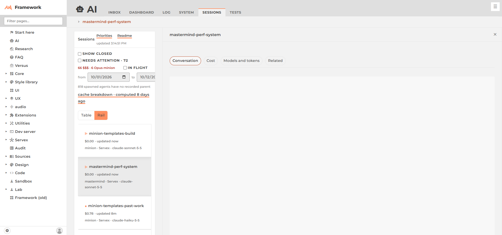

# data-grid: state

Brief: [requirements.md](requirements.md). Landed on `michael/dev`: grid core `137750706`, Sessions `fa8b19bc9`.

## Decided
- Architecture: [ext/DataGrid/doc/architecture.md](/framework/ext/DataGrid/doc/architecture.md). ext/DataGrid is the base; ui/datagrid and ui/table fold in as statics with re-exports; table and rail are drawers picked by a `view` setting (url > the reader's toggle > `settings.jsonl` > "table"); Page owns row → detail via `route(id)` + `columns()`.
- Alternatives rejected: `view` as a seventh Page word; a `RailGrid extends DataGrid`; ui/datagrid as the base.

## Done
- ✅ One grid: `ui/datagrid`, `ui/table` re-export `ext/DataGrid`; nothing deleted.
- ✅ Sessions on it: recency order, nesting, sort, month loading, live row updates, resize (widths saved), flags all kept; `ext/grip` gone from this page.
- ✅ Rail view: one card per session, detail opens beside; Table / Rail toggle; default `{"settings":{"view":"table"}}` in `ai/sessions/settings.jsonl` (change to "rail" once the owner's drawing picks it).
- ✅ Numbers (same script, 3 runs × 4 widths, [results](sessions-perf/results.jsonl)): long tasks ~430–680 ms → ~50–130 ms; DOM ~5,900 → ~2,700; first row about the same (noisy). Shots: `sessions-perf/before-*.png`, `after-table-*.png`, `after-rail-*.png`, `after-rail-detail-1920.png`.

## Left
- With nothing open, the Sessions page in rail view shows empty column outlines to the right (core/Page columns' empty state).
- `session-flags.json` 404s on the main site (not from this task; it was there before).
- Old branches `worktree/data-grid` (2026-10-03) and `worktree/data-grid-2` (merged) are left; `data-grid-3` worktree can go down.
- minion-sessions-adopt stalled at a Servex restart with its work uncommitted; the mastermind reviewed, fixed and committed it.
