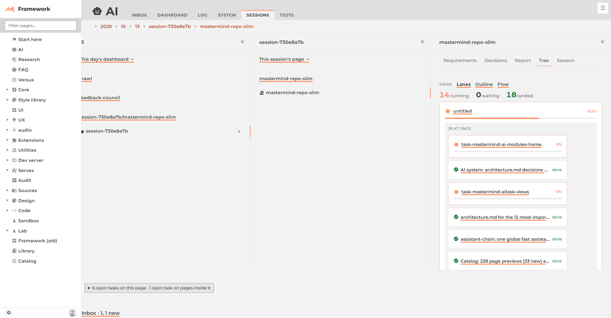
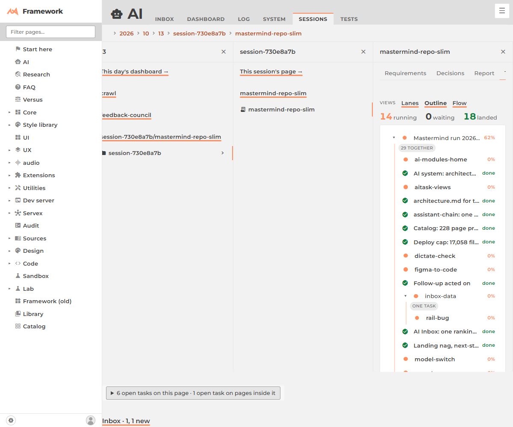
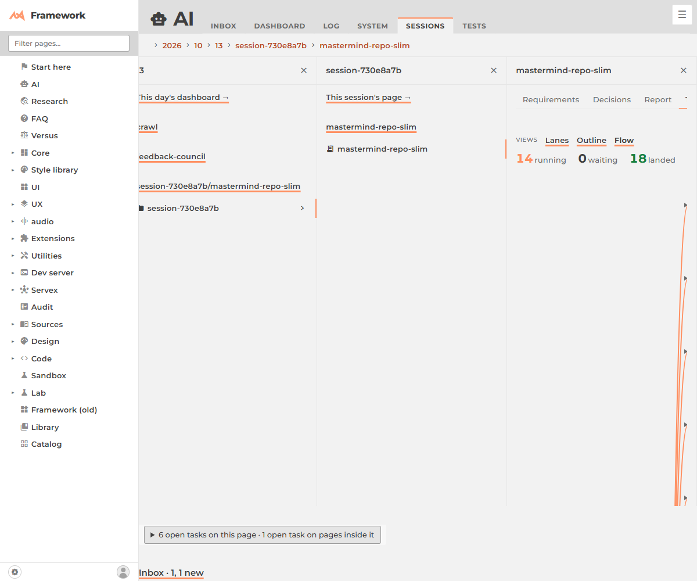

# AITask views: what each one shows, and who uses it (checked 2026-10-13)

One screen. The owner asked ([ask 3](/framework/ai/sessions/2026/10/13/session-730e8a7b/mastermind-repo-slim/requirements-10.md)) whether the tree, lanes, outline and flow views are wired to anything. They were built on 2026-09-29 by [nested-tasks](/framework/ai/sessions/2026/09/29/44287d42-678f-4d18-8e96-5029b1e971d3/nested-tasks/) and [minion-view](/framework/ai/sessions/2026/09/29/44287d42-678f-4d18-8e96-5029b1e971d3/nested-tasks/minion-view/); until today only the [Task tree](/framework/ai/AITask/tree/) page used them, and it read a frozen listing, so it showed nothing for any day after 2026-10-09.

## The task tree views (`nested.js`, class `TaskTree` and three subclasses)

| View | Shows | Used by |
|---|---|---|
| **Lanes** (`Lanes`, default for small tasks) | phases left to right, tasks in one column ran together, "then" between | the Tree tab of every task page; [/tree/](/framework/ai/AITask/tree/) (today's tasks); [/tree/lanes/](/framework/ai/AITask/tree/lanes/) and [/tree/demo/](/framework/ai/AITask/tree/demo/) on a made-up plan |
| **Outline** (`Outline`, default above 8 subtasks) | an indented list, one line per task, folds | the Tree tab; [/tree/outline/](/framework/ai/AITask/tree/outline/) |
| **Flow** (`Flow`) | a node graph, an arrow per "waits for" | the Tree tab; [/tree/flow/](/framework/ai/AITask/tree/flow/) |

Screenshots, all on this run's own task, `mastermind-repo-slim` (32 tasks inside it):   

Flow is the weak one: with 29 subtasks in one phase it draws one arrow per task and runs off the pane. It suits a task with a few phases and a few subtasks each; the tab keeps it, the default skips it.

## Where they are wired now

- **Task page** (`AITask.js`, the page a card opens): a **Tree** tab appears when the task has tasks inside its folder, with the Lanes / Outline / Flow switcher (`TaskViews.js`; `?view=outline` is the route, and opens the tab). The mastermind run task and every sub-mastermind get it; a leaf task has no tab.
- **A day** ([/tree/?date=](/framework/ai/AITask/tree/)): now reads the dev server's task index, not `directory.json` (frozen), so today shows.
- Both read `tree.js`: `tree_for_task(dir)` and `tree_for_day(date)`. Off the dev server there is no index and no Tree tab.

## The other views in the module

| File | Shows | Used by | Built |
|---|---|---|---|
| `board.js` | cards on a time spine, a heading where the day changes | `dashboard.js`, `ai/v/3/timeline.js` | 2026-08-16 |
| `replay.js` | `load()` reads a session's transcript lines | `ai/AISession/AISessionDetail.js` (only `load`; the `replay()` bar is unused) | 2026-08-15 |
| `rank.js` | drag to rank, the `rank` verb | `asks.js`, `decisions.js`, `Ask/reply.js` | 2026-09-21 |
| `plan.js` | the made-up plan the three tree designs are compared on | `tree/design.js` (the demo pages only) | 2026-09-29 |
| `feed.js` | a newest-first stream of a session | **nothing**: `conversation.js` replaced it (see its header) | 2026-08-15 |

## Candidates to retire (nothing was deleted)

- `feed.js` + `feed.css`: wired to nothing since the Session tab chat replaced it.
- `replay.js`'s `replay()` export: nothing calls it; `load` is the live part.
- The `/tree/demo/` page is an alias of Lanes on the made-up plan; keep it as the "what do the marks mean" page.

## Limits

The task index rows carry no `parent_task` or `after`, so a task's tree is nested by folder and phased by start and landed times (a "waiting" mark needs `after`, which only `tree_for_day`'s old file path had). Adding both fields to `SessionIndex` rows would make the Tree tab exact: a small change in `Server/`, not made here.
