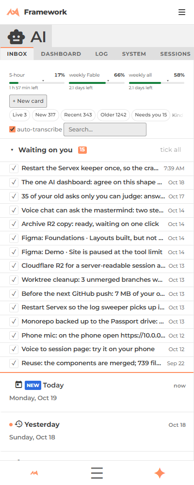
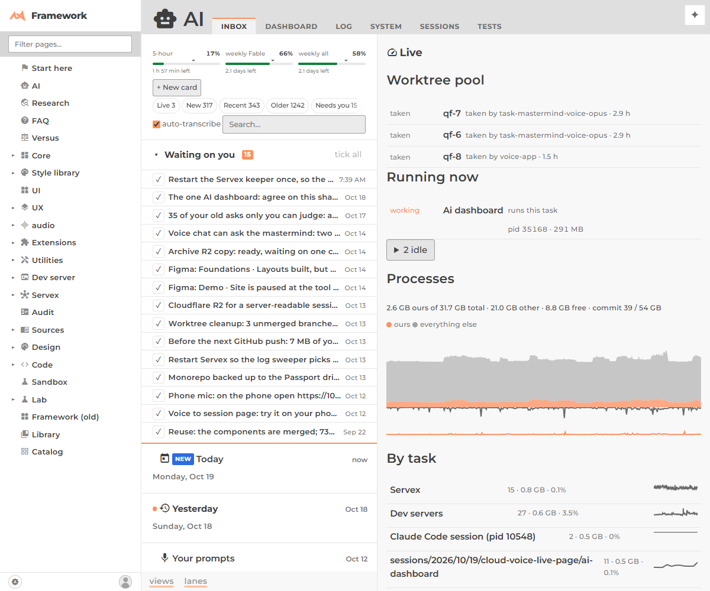

# The AI dashboard: plan, approved page, and what slice 1 shipped

**Built (slice 1, 2026-10-19):** `/framework/ai/` is now the dashboard; its structure is in [AIDashboard/readme.md](../AIDashboard/readme.md). The sections below are the plan it was built from. Where they differ, the approved page just below wins.

## The approved page (the owner, 2026-10-19: "get working on something, we will fix it later")

Top to bottom: **(1)** one usage line (the existing pace meters); **(2)** the chosen day's sessions grouped by origin, **Voice** (cloud voice agent), **VS Code**, **Scheduled** (plus **Servex**, the agents a task spawned that are not yet under their parent), one row each: plain-words name, when, cost, state, tap to open; **(3)** inside a session: his words, agents spawned nested with costs rolled up, what landed; **(4)** older days: a day list beside the page on desktop, a date picker on the phone.
Not on it: top tabs, inbox cards, active-task lists (a count and a link only), snippets. The old Inbox is **one** link at the bottom.
**Slice 1 does 1, 2 and 4.** Part 3 is the existing `/framework/ai/sessions/<id>/` page the row opens; its "his words / nested / landed" layout is the next slice. The class table in section 4 is as built except that `AIDashboard` is a `View` (the root page keeps `page.js`), and `UsageLine` is added.

**What you asked (2026-10-19):** open `/framework/ai/` and click through everything the agents did today and yesterday. Group it by session and by where it came from (a cloud voice agent, or a VS Code / phone tab acting as a mastermind), nested: each one spawns sub-masterminds and minions. Compact, mobile first, no top tabs, cost added up the parent chain, nothing unaccounted for. One data store.
Task and brief: [ai-dashboard task](/framework/ai/sessions/2026/10/19/cloud-voice-live-page/ai-dashboard/task.jsonl) · past work found: [past-work.md](/framework/ai/sessions/2026/10/19/cloud-voice-live-page/ai-dashboard/past-work.md).

## The answer in five lines

- **Most of the store exists.** Every session is already a row in that day's `ai/sessions/YYYY/MM/DD/index.json` (cost, model, state, parent, agent), and every task is already a row in `ai/state.json`. The new page only reads them: no new store.
- **Two things are broken, and the page cannot be honest until they are fixed:** a child names its parent by *agent name* but the session row is keyed by *session id*, so `children` is 0 and `tree_usd` equals `usd` on every row (no roll-up exists); and 24 of the 26 helpers and reviewers spawned today have no parent at all.
- **Origin is not stored**, but it is computable from what is there (table below).
- **The first slice** is today's sessions, three origin groups, nested to three levels, cost rolled up, read from the existing files.
- **The Inbox and its tabs stay**, one link away at `/framework/ai/inbox/`.

---

## 1. Data audit (computed, 2026-10-19 20:45; numbers come from scripts, not memory)

| Thing | Where it lives today | Written by | Verdict |
|---|---|---|---|
| **A session** (VS Code tab, Servex agent) | one row per transcript in `ai/sessions/YYYY/MM/DD/index.json` (`snapshots[]`); folder `session-<id8>/` | `AISessionIndex` (the one writer, reads `~/.claude/projects` transcripts) | good: 88 rows on 10-19, 58 on 10-18 |
| **A cloud voice session** | folder `cloud-voice-<name>/session.jsonl`, line 1 `{session:{kind:"cloud-voice-agent",caller:"voice-app"}}`; the registry row `voice-app` (state `external`) | the `cloud_voice_log` tool ([voice-logging](/Servex/ext/remote/doc/voice-logging.md)); built today, live after the next Servex restart | **partly**: today's two folders are hand-written; not yet in `index.json` |
| **A Servex agent** (mastermind, minion, reviewer, helper, clarity…) | `registry.json` in `%LOCALAPPDATA%/lew42/servex/` (3,294 rows: `parent`, `task_dir`, `cost`, `turns`, `started_at`, `state`) and the same agent as an `index.json` row (`agent` = its registry id) | Servex (`Agents.js`) | good: every one of today's 69 agent rows joins to its registry row |
| **A task** | `task.jsonl` in the session store, or in a module's `tasks/` home | agents via the item tool; folded by `Server/State.mjs` into `ai/state.json` (self-checked) | good ([one-state](one-state.md)) |
| **Spawn link (parent → child)** | registry `parent` (an agent id); `index.json` `parent`; task line 1 `parent_task`; a minion's folder nested inside its parent task's | whoever calls `spawn_agent` *passes* `parent`; nothing fills it in | **broken**, see below |
| **Cost** | `usd` per session row (read from the transcript, `AISessionCost`); `cost` per registry row (sum of its `turn_cost` log lines, `Agents.logged_cost`) | two different readers | **duplicated**: today 736 $ in rows vs 319 $ in registry rows; the 646 $ is one VS Code session, which has no registry row |
| **Cost roll-up** | snapshot fields `tree_usd` and `children` | `AISessionIndex` | **empty**: on 10-19 `children` is 0 on all 88 rows and `tree_usd` equals `usd` on all 88 |

### What is missing, stated plainly

1. **The join key is wrong.** `index.json` `parent` holds an agent id (`voice-app`, `task-mastermind-voice-opus`); the row's `id` is a session uuid. Of 12 rows with a parent, 0 match a row id (5 match a row's `agent` name). That is why nesting and roll-up never worked.
2. **Spawns are not all tracked.** Today by role: mastermind 1 of 5 has a parent, task-mastermind 5 of 5, minion 3 of 3, **reviewer 2 of 14, helper 0 of 10**. `spawn_agent` stores the `parent` the *caller passes* (`Agents.js` line ~317); a caller who omits it leaves an orphan. 21 `clarity` and a few more are started by Servex itself and have no parent by design.
3. **VS Code masterminds are only parents if they registered.** A tab that never calls `register_session` has no registry row, so what it spawns hangs from `parent: null` or from a made-up name. The 646 $ "Ultracode" session is exactly that: its children cannot be added to it.
4. **Origin is not a field.** Today it is guessed in three places (`AISessionSource.source_of`, the folder name, the `kind` line).
5. **Cost has no single owner.** Two readers, two answers, and no roll-up.

### The root `ai/` directory

There is **no `ai/` at the repo root** (checked: it does not exist, and git has never tracked one). What you are remembering is the **per-directory `ai/` folder**: 30 of them (`public/ai`, `public/framework/ux/Dictate/ai`, `Servex/ai`, …), each holding a `log.jsonl` of session-start lines and the voice chat files `v-*.jsonl`, made by the `dir_log` tool and the voice chat (built 2026-09-28, [cards-and-logs](/framework/ai/sessions/2026/09/30/cards-and-logs/cards-and-logs/requirements.md)). **Only `public/ai/` was written today** (the voice chat); the other 29 last changed between 09-04 and 10-17. It is a second, dormant index of the same sessions. The dashboard will not read it; a module's history is the session store filtered by module (`task.module`), which is the same answer without a second store.

### The one store, named

**The sessions store: `public/framework/ai/sessions/YYYY/MM/DD/`.** The folders are the record. Two computed views of it, each with exactly one writer, are the only files the dashboard reads:

- `…/DD/index.json`: sessions (id, agent, parent, cost, state, times). Writer: `AISessionIndex`.
- `ai/state.json`: tasks, asks, cards (landed, open, in flight). Writer: `Server/State.mjs`.

The registry (`registry.json`) is Servex's live bookkeeping; the dashboard never reads it directly. Anything it knows that the store needs (spawn parent, cost) is **written into the session row** by `AISessionIndex`.

---

## 2. The fixes the page needs (in this order; each small)

1. **A parent is a session id.** `AISessionIndex` resolves the registry parent (`voice-app`) to the parent's session id once, when it builds a row. A cloud voice parent resolves to its `cloud-voice-<name>` folder id. Result: `parent` joins, `children` is real.
2. **Roll-up in the writer.** The same code adds `tree_usd` (own + every descendant's) and `children`. One place, so the old Sessions grid gets true numbers too.
3. **Every spawn gets a parent.** `spawn_agent` defaults `parent` to the *caller* (the MCP already knows who called: a local agent id, or `voice-app`). A fallback for the orphans that already exist, computed when the page loads: the nearest enclosing task folder's agent (a task nested in `…/task-x/` belongs to task-x's agent).
4. **`origin` becomes a field** of the row, computed in one function, `AISessionSource.origin(snap)` (below), used by the dashboard and the old grid.
5. **One cost.** The row's `usd` stays the number; the registry `cost` is checked against it, and a difference over 5 % shows as a flag, not a second figure.

Steps 1, 2 and 4 are in `AISessionIndex` (node, dev-server side). Step 3 is in Servex (`Agents.js`, takes effect at the next Servex restart; I will leave the restart to you). Slice 1 below does 1, 2 and 4 **in the browser** from the existing files so the page works today; moving them into the writer is slice 2.

---

## 3. The page

### The row: nothing else on it

Ranked, left to right (at 400 px the last ones wrap under, the first four never do):

1. **origin** (icon only: ☁ cloud voice · ⌨ VS Code / phone · ⚙ Servex)
2. **name** (the title; the agent id as a small second line only for Servex agents)
3. **state** (a dot: working / idle / landed / stalled)
4. **cost**, own and rolled up: `$2.91 · $149` (own · with everything under it); a leaf shows one number
5. **duration** (started → last activity, `2 h 10`)
6. **asks** and **landed**: `3 asks · 2 landed` (from `state.json`; hidden when 0)

Started time is the row's group heading (a time-of-day rule), not a column. Everything else (model, turns, tokens, files, tags, task lines, the transcript) is one click down, at the session's own URL `/framework/ai/sessions/<id>/`. A row is a link, so reload and back land in the same place.

### Origin rules (one function, computed, never typed)

| Origin | How it is known |
|---|---|
| ☁ **cloud voice** | the folder is `cloud-voice-*`, or its `session.jsonl` line 1 says `kind: cloud-voice-agent`, or the registry row is `state: external` |
| ⌨ **VS Code / remote** | a transcript row with no `agent`: a VS Code sidebar tab, which includes the phone and PC copies of the same remote-control session (one transcript, so one row; it cannot be told apart and does not need to be) |
| ⚙ **Servex** | the row has an `agent`: a mastermind, task mastermind, minion, reviewer, helper. These always appear *under their parent*; only the ones with **no** parent (clarity, dispatcher, fixers: started by Servex itself) are a root, and they fold into one "Servex, routine" line with a count and total, like the Sessions page buckets already do ([buckets](/framework/ai/sessions/doc/buckets.md)) |

### Navigation (no tabs)

- **Day strip** across the top: `‹  Today · Yesterday · Sun 18 · Sat 17 …  ›`, each day a link `?day=2026-10-18`; the day's total cost and count under it. At 400 it scrolls sideways by itself (a strip, not a stacked tab bar).
- **Two filter chips, one row:** origin (all / ☁ / ⌨ / ⚙) and state (all / working / needs you / unfinished). Both are in the URL (`?origin=cloud&state=open`), so every view reloads the same.
- **Search** is the existing one (matches the session's title, agent, tags).
- **Nesting to 3 levels**, collapsed by default except along the path to anything working: ☁ voice → task mastermind → minion. Tap the row's caret to fold; the fold state is a URL part (`?open=<id,id>`), not a hidden setting.
- **A link row at the bottom of the page and in the menu:** `Inbox and the old tabs →` (`/framework/ai/inbox/`), `Sessions grid →`, `Tasks →`.

### Phone at 400 px

```
┌────────────────────────────────┐
│ AI              ‹ Today ›  $162│  one line: title, day, day total
│ Today  Yest  Sun18  Sat17  →   │  day strip (scrolls sideways)
│ [☁ ⌨ ⚙ all]  [open ▾]  🔍      │  two chips and search
├────────────────────────────────┤
│ ☁ live page         ● $0 · $198│  origin root, rolled-up cost
│  ▾ ⚙ ai-dashboard   ● $0.8     │   child
│     ⚙ minion-x      ○ $0.2     │    grandchild (3rd level)
│  ▸ ⚙ voice-logging  ○ $16 · $24│   folded: caret shows it has more
│ ⌨ Ultracode         ○ $646     │  VS Code root
│  ▸ ⚙ Servex, routine  44 · $9  │  folded bucket
├────────────────────────────────┤
│ 3 asks open · Inbox · Sessions │  the old pages, links
└────────────────────────────────┘
```

Each row is one line (name truncates, cost never does); the second line (duration, asks/landed) appears only for a row that is open or working. At 1200 and wider the same rows sit in one column beside a detail pane that opens on click, the way the Sessions page already peeks.

---

## 4. Class architecture

Home: **`public/framework/ai/AIDashboard/`** (the name `ai/dashboard/` is taken by the live-preview grid, and `AI` + noun is the folder rule, [module-homes](module-homes.md)). One class per file; `page.js` stays tiny.

| Class | Job | Relation |
|---|---|---|
| `AIDashboard extends View` | the page body `/framework/ai/`: reads the url (day, origin, state, open), owns the store, draws the day strip, chips and the tree. **The orchestrator.** | extends `core/View`; composes the others |
| `SessionStore` | loads one day's `index.json` and `state.json`, fixes the join (agent id → session id), computes `origin` and the roll-up; `rows(day)` returns the tree. Dies in slice 2 when `AISessionIndex` does this and the store only reads. | composes `ext/JSONL` / `DashState` for the live tail (code streams, [law](/CLAUDE.md)) |
| `SessionTree` | a node: `{session, children, own, rolled, depth}`, `open` set, `walk()` | plain class, no DOM; the thing the page's debug view prints |
| `SessionRow extends View` | the one row (fields above), draws itself from a `SessionTree` node | extends `core/View`; **reuses `AISessionView`'s cell helpers and `DashRow`'s state dot** rather than a second row type |
| `DayStrip extends View` | the day links, totals, ‹ › | uses `Day.of` ([core/Session/Day.js](/framework/core/Session/Day.js)) so "today" is the same local day as `State` |
| `UsageLine extends View` | the one-line meter: `UsagePace.ratio` per limit from `ai/usage.json` | reuses `ai/usage/UsagePace.js`, no second meter |
| `OriginChips extends View` | origin and state chips, written to the url | reuses the `DashChips` url mechanism (its `read()`/`write()` shape), not a second one |

Reused as is: `DashRow` (state mapping), `DashState` (the `state.json` stream), `AISessionBuckets` (folding routine rows), `ext/DataGrid` only for the wide detail pane if it earns it. **Show the class** (CLAUDE.md): the page's `?debug` shows the `SessionTree` of the day beside the rendered list.

---

## 5. The smallest first slice, and what it will not show

**Builds** (a worktree, one new folder, a swap of `page.js`'s default content): today and yesterday's `index.json` + `state.json` → a tree grouped ☁ / ⌨ / ⚙, nested three levels, rolled-up cost in the browser, day strip, the origin chip, rows as above, links to the old Inbox/Sessions/Tasks, checked at 400, 1200, 1920 and 3440. The page does not scroll inside its scroll, and nothing is sticky.

**Will not show yet:**
- the state chip's *unfinished* (needs the lifecycle in [task-lifecycle.md](task-lifecycle.md), written by `task-mastermind-task-system`);
- cloud voice sessions beyond the hand-written folders (the writer is live after a Servex restart);
- **honest cost for orphans**: a reviewer or helper with no parent sits under "unattached", not under its real parent, until step 3 (spawn defaults the parent) ships, with a count in red so it cannot be missed;
- any VS Code tab's spawns unless that tab registered;
- days older than yesterday (the strip links them; they read the same files, so they will work as soon as slice 1 does, but I will check three of them before saying so);
- a full-text search over prompts, and the Coverage tab (stay on the Sessions page).

"No sessions unaccounted for, no tasks unfinished" becomes a **line at the top of the page**, computed: `88 sessions · 4 unattached · 2 tasks unfinished`, the self-check pattern `State` already uses, red when a number does not add up.

## Coordination

- `task-mastermind-tasks-layout` keeps the Inbox view and its toolbar; I take `page.js`'s default route only. Before touching `ai/readme.md` or `page.js` I message it and `task-mastermind-task-system`.
- This plan is linked from [ai/readme.md](../readme.md). Screenshots of today's page, for the record (before): at 400 the page shows three pinned tab bars and a 15-row "waiting on you" list before the first session; at 1200 half the width is a process chart.



