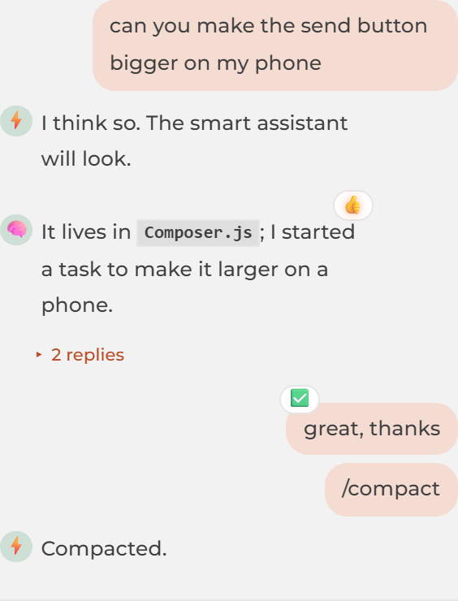
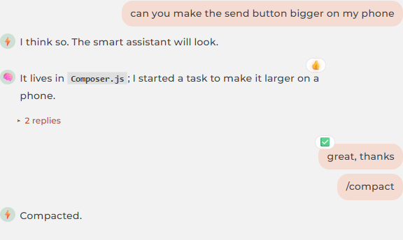
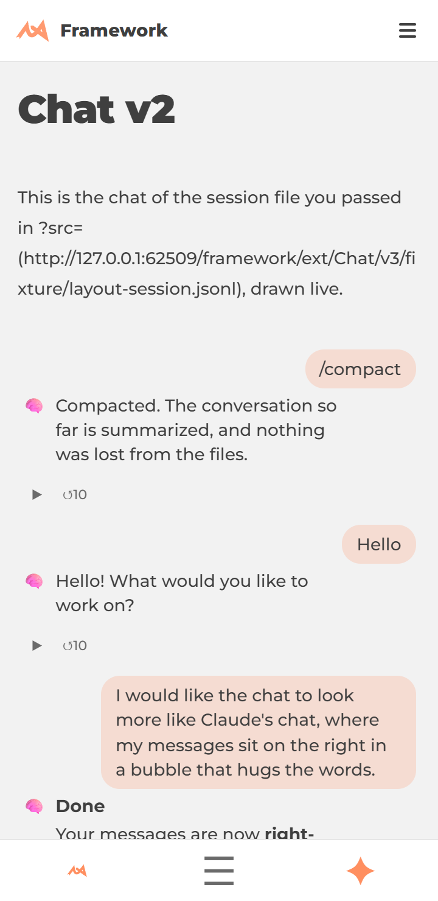
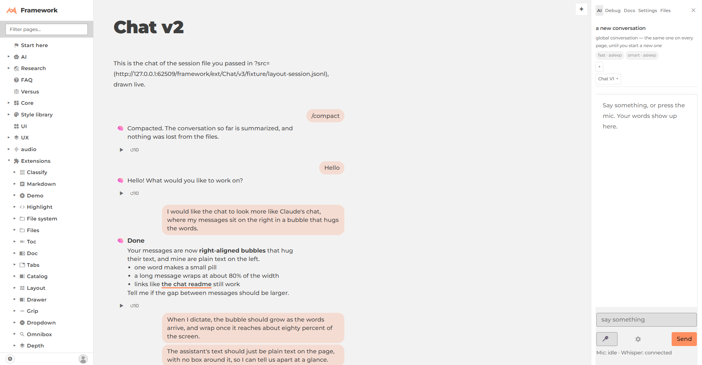
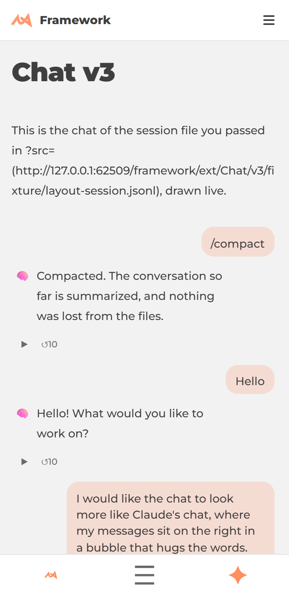
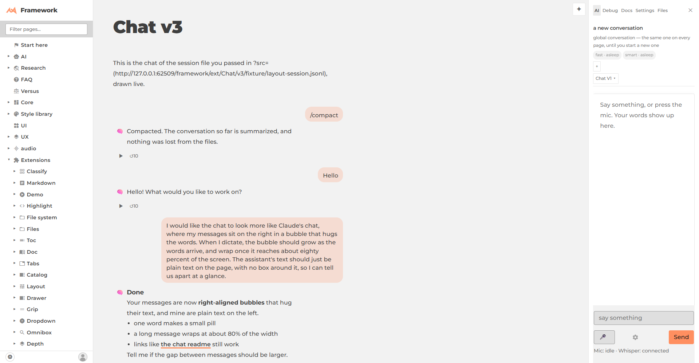

# Chat layout, the walkthrough (2026-11-02)

Your words are a tinted pill on the right that hugs the text; the assistant's words are plain text on the left. Both stop at 80% of the width (a `min(80%, 40rem)` cap on a desktop, so a line stays readable at 1920). One rule set, [`ext/Chat/bubbles.css`](/framework/ext/Chat/bubbles.css), draws all three views.

Shots are headless, at 360×740 (phone) and 1920, from the worktree's own dev server (this branch isn't on `monorepo.lew42.com` until it merges). Demo data: [`layout-session.jsonl`](/framework/ext/Chat/v3/fixture/layout-session.jsonl).

| View | Phone, 360×740 | Desktop, 1920 |
|---|---|---|
| **V1** (`ext/Chat/`, the ✦ sheet, the drawer) |  |  |
| **V2** (`ext/Chat/v2/`) |  |  |
| **V3** (`ext/Chat/v3/`) |  |  |

## What the numbers say
- No horizontal scroll: `scrollWidth` equals `clientWidth` (360 and 1920) in all three.
- Hugging: at 360 V3's owner pills are 91 px (`/compact`) and 60 px (`Hello`), against 259 px for the long message, which wraps at the cap; V1's are 106 and 82 against 225; at 1920 `/compact` is 104 px in V3 (the long one 499 px).
- Assistant bubbles have no fill (`background: rgba(0,0,0,0)`) in every view.

## It grows while you dictate
[`ext/Chat/v3/bubble-grow.mjs`](/framework/ext/Chat/v3/bubble-grow.mjs) sends the same `chat-live` event a mic does, with more words each step. The draft bubble widens, stops at the cap, then wraps:

- **V3:** 41 → 145 → 259 → 259 px at 360; 47 → 166 → 499 → 499 px at 1920.
- **V1:** 35 → 129 → 211 → 211 px at 360; 40 → 148 → 466 → 640 px at 1920.
- **Guess to settled:** same width (259 → 259), so no jump.

It runs in `node core/Test/run-all.mjs --browser` (14 checks).

## Fixed after the review
- V2's reply no longer starts 200 px to the right of the others at 1920: a sentence row now stretches to the column (`.chat-v2-sentence { align-self: stretch }`), and its reply is capped by the same `--bubble-max` as V3's (499 px at 1920, 259 px at 360).
- V2 no longer shows the muted first words above a dictated pill (a second copy of the same words): `.chat-v3-yours` hides it, as `.chat-v3-you` does.

## What was decided
- **V1's avatar is its own column.** A floated icon is left out of a bubble's intrinsic width, which squeezed a one-word reply ("Compacted.") to "Compa / cted." and let the second line wrap under the icon. A reply is now a two-column grid, icon then words.
- **Your 👤 icon is hidden in V1** (the right side already says who). The assistant's icon stays (fast, smart and a mastermind look different).
- **V2:** a sentence row is a small pill of yours; a reply anchored to it sits plain beneath it. A Prompt with refined text is one pill, as in V3. (`ChatV2.test.mjs` asserts `[data-sentence] .chat-v2-beside`, so the reply stays beside its sentence's row, in the DOM.)
- **The replay control** ▶/⏸ ↺10 (from the replay-bubbles task) sits under each plain reply at its left edge.
- **`--bubble-max`** is the one token for both sides: change it on any host to move both.
- **Alternative not taken:** a fixed 80% with no rem cap. On a 1920 page that is a 1500 px line, which reads badly; the cap is one value in `bubbles.css`.

## Checks run
`ChatV3.test.mjs` (18), `ChatV2.test.mjs` (19), `live-guess.test.mjs` (5), `ReciteBubble.test.mjs` (37), `Recite.test.mjs` (34, with the new same-opening-words test), the Dictate browser tests, then `node core/Test/run-all.mjs --browser`.

## Files
[requirements](requirements.md) · [past-work](past-work.md) · [review](review/report.md) · screenshots in [doc/screens/](doc/screens/)
