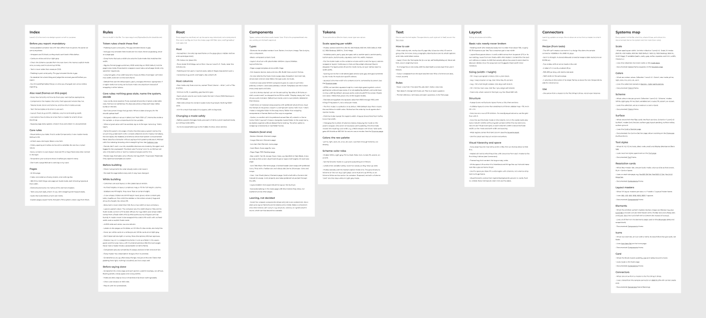

# AI page audit, and do agents read the rules? (2026-11-17, read-only)

Lew42 v2 (`ADpu9u2V0BlEZfR3rrMfER`), [AI page](https://www.figma.com/design/ADpu9u2V0BlEZfR3rrMfER/Lew42-v2?node-id=231-503). Your ask: the "Text" section of [owner-words-2026-11-17-naming.md](./owner-words-2026-11-17-naming.md#text-1750). Nothing in Figma was changed (2 `use_figma` reads, 1 screenshot).

## Conclusion

1. **The AI page does not show the rules.** [rules.md](./rules.md) says "the AI page shows the same list", but none of its 24 rules is on the page. The page's Rules frame is the older [build-checklist.md](./build-checklist.md). Rules 12 to 24 (compact pages, minimal Index, change safely, Masonry, clean instances, swap within a kind…) are missing entirely.
2. **The page is 3,264 words in 9 frames, and about half of it is stale or contradicts rules.md.** Cut it to **5 blocks and at most 1,300 words**: Start here · Rules · Glossary · Systems map · Root. Archive Components, Tokens, Text, Layout and Connectors once their few unique lines have moved.
3. **Agents read the rules only when their brief tells them to.** 35 of 58 Figma agents (16–17 Nov) opened the rules before their first Figma call. When the brief named the rules file, **31 of 31** read it. When it didn't, **4 of 27** did. The readme's pointer ("Every agent reads doc/rules.md first") is in the system prompt, but it is one line in a 15,204-word readme. And the `figma` skill sends agents to the readme's 12 November "Component strategy" instead of rules.md.

## 1. What is on the page

`Root` 231:503 (7248 × 3275, about 2.2:1) holds one column, `Root Column - AI` 242:12045 (6736 wide). In it are nine 720-wide frames, 231 text layers in all. Figma doesn't expose edit dates; the node ids show the order they were made (60:… first, 246:2 newest).

| Frame (id) | Words | What it says | Against the repo |
|---|---|---|---|
| Index 60:361 | 371 | Before-you-report checklist, list of frames, 6 core rules, page list | **Duplicate** of rules 2–4, 9, 10. **Contradicted**: "Index: one instance of every master" (rule 13: minimal, a schematic); "Wrappers are 5% black, so they stack" (rule 4: no darken/transparent tokens). |
| Rules 60:388 | 717 | Token rules, "core rules" (nothing goes stale, name the system, decide), before / while / done | **Stale copy** of build-checklist.md, not rules.md. **Contradicted**: "Big doc frames (5000 wide) stay on 1000 Default" (rule 7: Root on Mega, nothing 5000+); "Component sets … end in Set" as the general pattern (rule 6: no variant sets except small atoms). Unique and worth keeping: "a row whose children are all Fill height never grows", "make one title wrap", "check one instance at 400". |
| Root 246:2 | 193 | The Root and Root column spec | **Duplicate** of [root-spec.md](./root-spec.md), and current. Keep. |
| Components 60:413 | 446 | Types (Element/Block/Layout/Page), swap vs slot findings, the level-one masters | **Stale**: "waiting on approval"; "Layout.Sidebar … not built yet" (Layout.Sidebar Set exists); Card "on the Scale page for now". **Contradicted**: instance-swap with preferred values (rules 6 and 24). The types clash with the open vocabulary in [naming-brief-2026-11-17.md](./naming-brief-2026-11-17.md). |
| Tokens 60:432 | 405 | Scale modes and variables, squeeze, Colors, Scheme | **Stale**: "Three collections" (Surface is a fourth). Squeeze is marked both "OPEN, not decided" and "Decided and applied". The mode-placement lines repeat rules 5 and 19. |
| Text 60:450 | 154 | Pick a text style by role; fill bound to Scheme | **Unique**, mostly current. It already says the full reference is the Text page. |
| Layout 60:467 | 384 | Measure, parent-down sizing, a Fill/Hug table, structure, hierarchy | The Fill × Hug table is **unique** (glossary material). **Contradicted**: "A page is one vertical auto-layout frame" (rule 7: Root is horizontal); column width "bound to Scale width" (rule 23: Fill, not a width token); "one arrow from each master" (the readme: no connectors). |
| Connectors 99:533 | 134 | How to clone and route an arrow | **Contradicted** by the readme's Root rule: "There are no connectors; archive them, don't draw them." |
| Systems map 101:13905 | 460 | One entry per system: what, lives, documented | **Stale**: lists `display` (deleted 2026-11-16) and "12 variables" (Tokens lists 13). It presents Surface as the way to switch Card and Section (rule 15: a direct override), names "<width> / Layouts" folders (now `Layouts`), and has a Connectors system. [systems.md](./systems.md) is the checked version. |

Also: the page writes your first name 7 times. Use "the owner" (your global rule).

## 2. Proposal: 5 blocks, at most 1,300 words

| Block | Budget | Content | Source of truth |
|---|---|---|---|
| **Start here** | 80 words | What the file is; read the rules (repo `doc/rules.md`); finish with lint 0, a 1:1 screenshot and a different reviewer | this page |
| **Rules** | 600 words | The 24 rules: bold title plus one line each, in rules.md's order | rules.md, copied onto the canvas, never edited there |
| **Glossary** | 300 words, ≤ 25 terms | Tiers (`1920` = Desktop and the other seven), Root, Root column, Section, Container, Card, Content, Layout, Masonry, surface vs layout frame, Fill/Hug/Fixed (from the Layout table), Scale, Scheme | new repo `doc/glossary.md`; words the naming brief leaves open are marked "open" until you pick |
| **Systems map** | 200 words | System → collection or home page → repo doc. No counts (counts go stale). | systems.md |
| **Root** | 120 words | Today's Root block, trimmed | root-spec.md |

- **Move out, then archive** (into the page's hidden `Archive`, never deleted, per rule 14):
  - Components: its types go to the Glossary once the naming brief is decided; its swap and slot findings already live in [research/properties.md](./research/properties.md).
  - Tokens: collections and modes go to the Systems map and the Scale page; mode placement is rule 19.
  - Text: one Glossary line; the Text page is the reference.
  - Layout: the Fill/Hug table goes to the Glossary, the rest is rules 7, 8, 9 and 23.
  - Connectors: the recipe stays in the readme's "Native connectors" paragraph.
- **Shape:** two Root columns at 1920 (Start + Rules; Glossary + Systems + Root), so the Root comes out close to square (rule 12).
- **Keep it from going stale (compute, don't recall):** the Rules block is copied from rules.md by one script run. The repo file is edited and the canvas follows, never the other way round. Fix rules.md's false line "the AI page shows the same list" either way.
- **Where the glossary goes:** repo `doc/glossary.md` is the source, and the AI page's Glossary block mirrors it. The naming brief decides the words; until then the glossary carries only settled terms.

## 3. Do agents read the rules?

Method: [read-rate.mjs](/framework/ai/sessions/2026/11/17/spawned/mastermind-ai-page-audit/read-rate.mjs) reads each spawned agent's raw transcript. It finds the first Figma call and whether the agent opened rules.md first. For agents started before rules.md existed (born 2026-11-16 20:26), it counts `build-checklist.md` or a read of the AI page instead. "Read" means the file was opened, not that it was followed. Raw rows: [read-rate.json](/framework/ai/sessions/2026/11/17/spawned/mastermind-ai-page-audit/read-rate.json).

| Group | Read the rules first |
|---|---|
| Brief named the rules file | **31 / 31** |
| Brief didn't name it | **4 / 27** |
| Spawned with `path: ext/Figma/` (readme in the system prompt) | 23 / 26 |
| Spawned without the path (Sonnet minions) | 12 / 32 |
| Path given, brief silent | 2 / 5 |

- **Didn't read (23):** the first 11/16 wave: `figma`, `figma-explore-2600`, `-color`, `-icon-title`, `-sizing`, `-layout`, `figma-live-board`, `figma-2600-fix`, `figma-pages-modes`, `figma-playground`. The 19:31 study wave: `study-core`, `study-sizes`, `study-space`, `drop-test`, `master-homes`, `mode-split`, `swap-catalogue`, `scale-tokens`, `homes`, `scale-space`. Plus `roots`, `think-index`, `think-layouts`. All are from 11/16. Every 11/17 agent read rules.md as its first tool call.
- **Why the pointers fail:** the readme puts the rules line in paragraph 3 of 15,204 words. The [figma skill](/.claude/skills/figma/SKILL.md) says "Read first: the Component strategy section of the readme (the current rules)", which is the 12 November strategy for the old file and contradicts rules.md in places (slots for content areas, variant sets). And Servex loads the readme into the system prompt, but not rules.md itself.

**Cheap ways to make it reliable, best first:**
1. **A hook that checks** (about 30 lines, covers every agent, Servex or tab): `.claude/hooks/figma-rules-guard.mjs` runs before `mcp__figma__use_figma`. It refuses the first call in a session whose transcript has no earlier read of `ext/Figma/doc/rules.md`, and the message names the file. Project hooks already fire for Servex agents (the ledger hook does). It needs one line in `.claude/settings.json`, which is your config, so it is proposed here, not done.
2. **Point every pointer at rules.md** (doc edits, no approval needed): the figma skill's "Read first" line, and the readme's first line under the title.
3. **Put it in the path's system block:** a 3-line `public/framework/ext/Figma/mastermind.md` ("read doc/rules.md before your first Figma call; lint and reviewer before done"). Servex loads `<path>/mastermind.md` into every path-spawned agent's system prompt. This still misses Sonnet minions spawned without the path, which is why the hook comes first.
