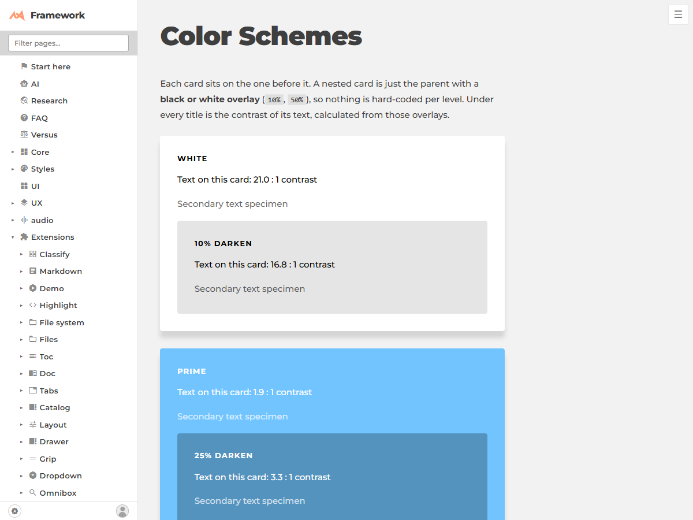
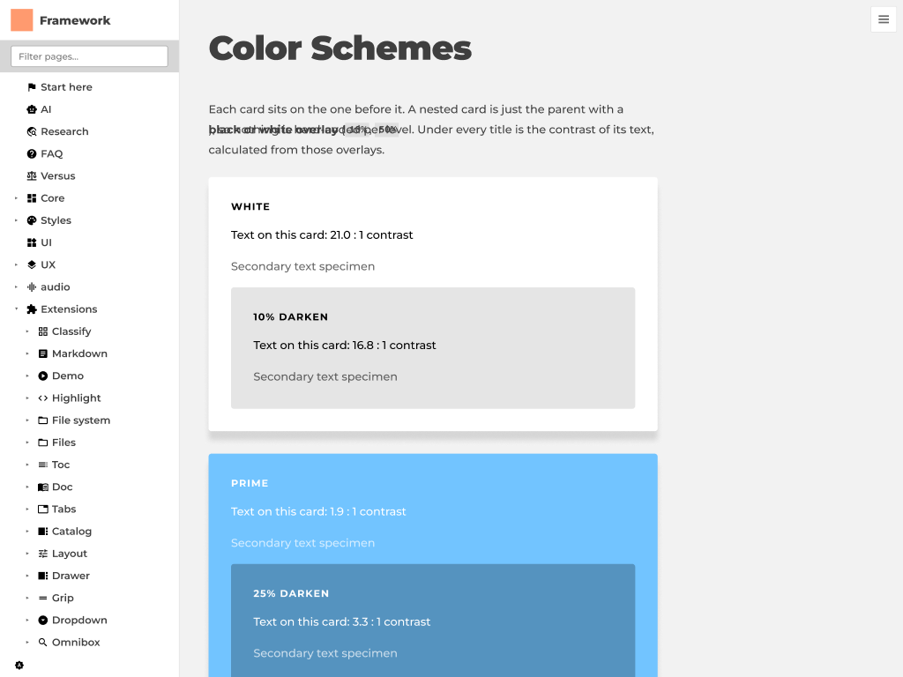

# Site page into Figma: `generate_figma_design` test (2026-10-10)

**Verdict: it works, and the picture is close, but the Figma copy is a frozen snapshot, not a responsive design.** Good for showing Figma's own agent what a page looks like; not a round trip.

Test: [/framework/ext/Figma/colors/](/framework/ext/Figma/colors/) from the local dev server, viewport **1200 x 900**, into the scratch file (`T5PuB8EhKhfyh0xtpIT1L0`, node `2:11`).

| Site (rendered) | Figma (after capture) |
|---|---|
|  |  |

## What happened

- The tool gives a capture id and a script. A local page needs that script injected and the page opened with the id in the URL hash; I used headless Chromium and `window.figma.captureForDesign({captureId, endpoint, selector: "body"})` (the Playwright route in the tool's own text). Then poll the tool with the id until it says completed. Took about two minutes in all, most of it the first load.
- **Only the viewport is captured (1200 x 900), not the full scrolling page.** The framework scrolls inside a container, so the capture ends at the fold. Capture a tall viewport (for example 1200 x 4000) to get the whole page.
- It captured the whole shell too (sidebar, menu button), 429 frames and 225 text nodes for one screen. Use `selector` to capture only the content.

## Fidelity

- Colours, spacing, text sizes, shadows, radii: match to the eye. Contrast numbers read the same.
- **Wrong:** a paragraph mixing plain text with `<strong>` and `<code>` came out as overlapping text (inline flow does not survive; it becomes absolutely placed pieces). The SVG logo became a flat orange square. Text weights look slightly different (not measured).
- **Layout is frozen:** every node has fixed x/y/width/height; `get_metadata` shows no auto layout. Resizing the Figma frame does not reflow anything.
- But `get_design_context` on one card returns a **grid**: `grid grid-cols-[537.14px] grid-rows-[18.28px 26.86px ...] gap 14.92px p-[29.84px]`. That is our `.fg-scheme` (`display:grid`, `gap:1em`, `padding:2em`, 1em = 14.92px), recovered with the original em values as pixels, but with fixed tracks. So the signal "this was a grid with this gap and padding" survives; the responsive part (`1fr`, `minmax`, `auto-fit`) does not.
- Output over about 90 KB comes back as a sparse tree only; ask `get_design_context` on sub-nodes.

Mapping Figma properties to framework words: [doc/mapping.md](./mapping.md).
