# Page audit: every page in Lew42 v2 (2026-11-16, read-only)

Screenshot audit of every page in the Lew42 v2 file (`ADpu9u2V0BlEZfR3rrMfER`) except `AI` (read for its rules, not audited) and `Live` (owned by `mastermind-live`, skipped). Checked against [build-checklist.md](./build-checklist.md) and the AI page's `Rules` frame. Nothing in Figma was edited; every finding below is a proposal for whoever owns that page next. Screenshots: `page-audit/<page>-<n>.png` (new) and the `2600xl-*.png` files already on disk from Brief C's before/after passes, reused here instead of re-shooting a page that just landed.

## The two biggest problems, found once and true everywhere

1. **Every button's label fails contrast, on every Scheme.** [Explore – Color permutations' summary matrix](#explore-color-permutations) computes real WCAG numbers per card: the button label (white `on-accent` text on the orange accent) measures **2.6**, against a 4.5 AA floor, in all 16 outer-scheme × inner-scheme pairings, and the raw card grid repeats the same `FAIL 2.6` pill on literally every card it drew. This is not a demo artifact — it is the live `Button` component's own colour, so it is wrong on every page that uses a button: Index, every size page, 1600 LG, 1920 Desktop, Elements, Squeeze, Drag playground, and both Columns.* sections of 2600 XL. One token fix (darken the accent or darken the label) fixes all of them at once.
2. **Prime-scheme text also fails contrast, independent of the button problem.** The same matrix shows the Prime column's body/muted text at **2.6** against every outer scheme (White, Light gray, Prime, Dark) — Prime is not yet an approved scheme ([readme](../readme.md), "Scheme contrast"), and this audit confirms why: its text is not readable by WCAG AA at any pairing tested.

## Table

| Page | Verdict | Top problem |
|---|---|---|
| [Index](#index) | Clean | none found |
| [360 XS](#size-pages) | Clean | card content doesn't use the width (see "size pages" note) |
| [400 Mobile](#size-pages) | Clean | same |
| [600 SM](#size-pages) | Clean | same |
| [1000 Default](#size-pages) | Clean | same |
| [1600 LG](#size-pages) | Clean | none beyond the global button issue |
| [1920 Desktop](#1920-desktop-in-flux) | In flux (owner editing) — clean where checked | — |
| [3440 Mega](#3440-mega) | Needs work | huge voids: header band and both sidebar rails are mostly empty gray at 3440 |
| [Elements](#elements) | Clean | none found |
| [Icons](#icons) | Clean | none found |
| [Scale](#scale) | Clean, reference-only | tiny card relative to 3440/2600 columns (same family as the 3440 Mega void) |
| [Squeeze](#squeeze) | Clean | none found |
| [Explore – Sizing](#explore-sizing) | Clean | none found |
| [Explore – Color permutations](#explore-color-permutations) | **Functional find** | button + Prime contrast fail everywhere (see above) |
| [Explore – Icon + title](#explore-icon-title) | Clean | none found |
| [Explore – Figma → CSS](#explore-figma-css) | Clean | none found |
| [Explore – Legacy vs Latest](#explore-legacy-vs-latest) | Clean | none found |
| [Explore – Drag playground](#explore-drag-playground) | Clean (by design) | empty drop-zone columns are the intended starting state |
| [2600 XL](#2600-xl-audited-last) | Landed, mostly clean | parked masters checked for overlap below — none found |

## Index

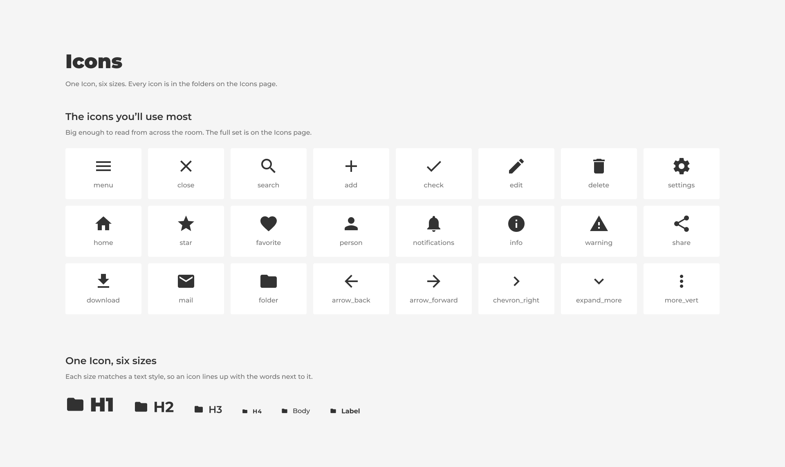

**What's on it:** the `Icons Preview` instance — a page titled "Icons", an intro line, an 8×3 grid of the most-used icons (menu, close, search, add, check, edit, delete, settings, home, star, favorite, person, notifications, info, warning, share, download, mail, folder, and 4 arrow/chevron icons), then a "One Icon, six sizes" row showing the folder icon at H1–Label sizes next to the matching text style.

**Eye lands:** the "Icons" H1, then the grid.

**Problems:** none. Clear hierarchy (H1 → H2 → body), consistent card grid, no voids, text all styled.

## Size pages (360 XS, 400 Mobile, 600 SM, 1000 Default, 1600 LG)

Each is one frame: a page-size title (`h1`), a `Page master` instance, then one `Layout.Columns.One Set` card demo. All five are internally consistent and clean — no overlaps, no clipped text, correct one-column-at-mobile behaviour.

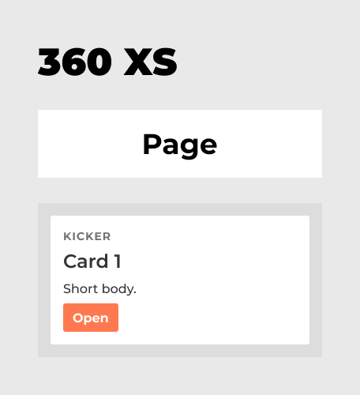 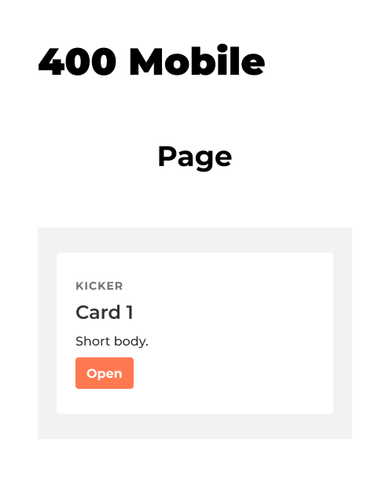 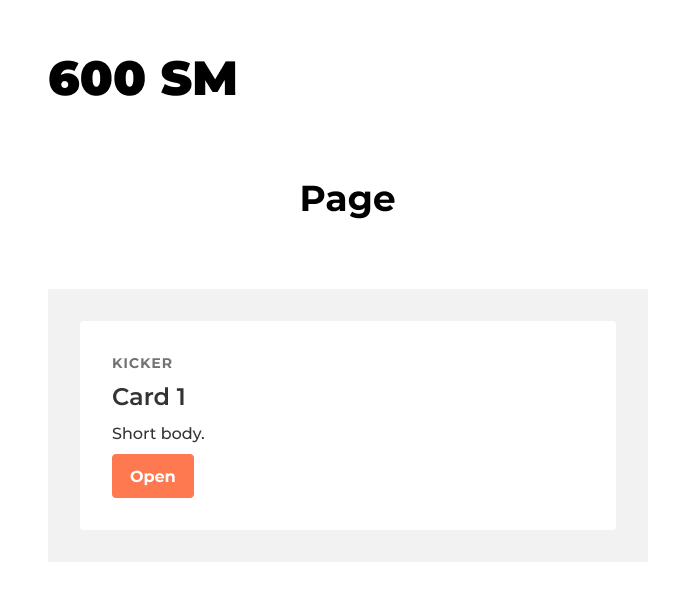 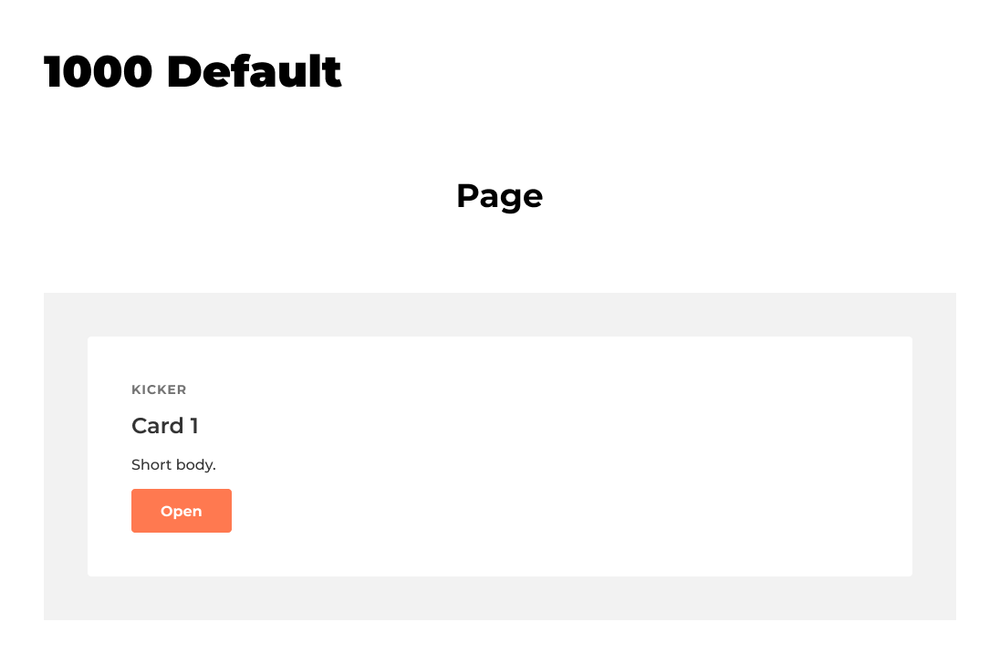 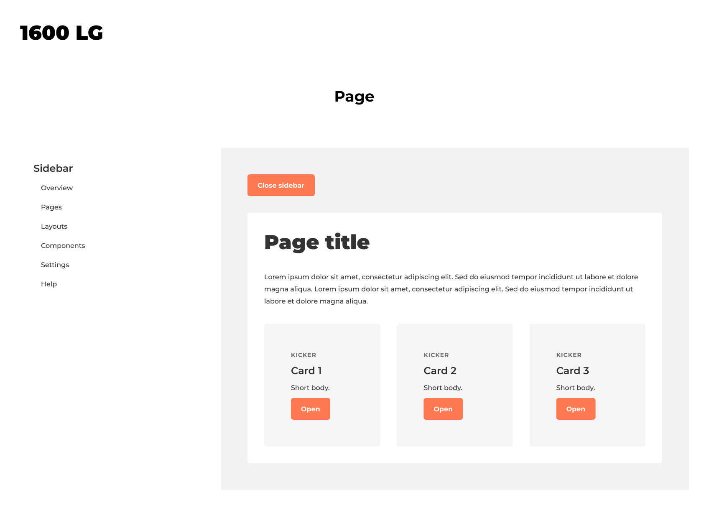

**Eye lands:** the page-size title, then the "Page" master label.

**Problem, growing with width:** at 360–600, the single demo card's kicker/title/body/button content fills most of the card. At 1000 Default the same content sits left-aligned in a card that is now Fill-width, leaving roughly half the card empty on the right; this would get worse at 1600+ if the same one-card demo were used there (1600 LG instead switches to the 3-card Sidebar Set demo, which is why it looks fine). **Fix:** cap the `Layout.Columns.One Set`'s single-card demo content at a measure width, or swap it for a 2–3 card grid once width passes ~800, matching what 1600 LG already does.

**Minor, not scored above:** the `Page` master has a light-gray background box behind its title at 360 XS, but renders with no visible background (just floating centered text on white) at 400/600/1000/1600 — worth a look at whether that's an intentional Scale-mode change or a missed override, but it doesn't affect readability.

## 1920 Desktop (in flux)

Owner is editing this page by hand; audited read-only, two of its three top-level regions shot (the "Pages · one per Scale mode" thumbnail strip was skipped as low-risk).

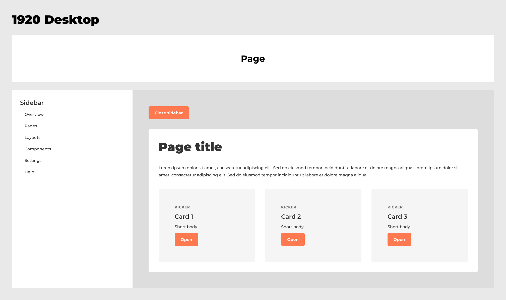
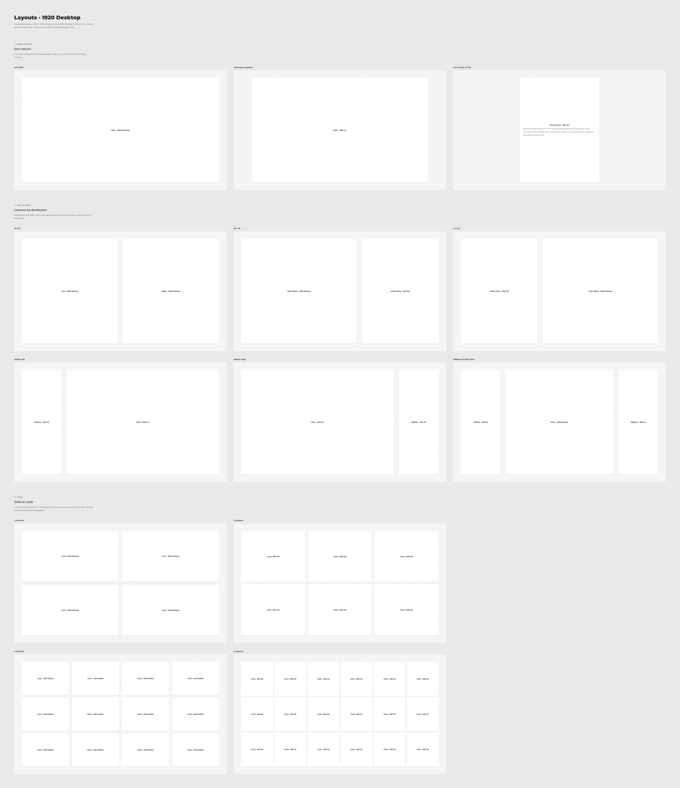

**What's on it:** a `Page · 1920 Desktop` demo (Sidebar + 3-card main, same pattern as 1600 LG) and a `Layouts · 1920 Desktop` catalog of 13 viewport examples (1 column full-width/centred/text-column, 2-column splits 50/50-60/40-40/60, 3 sidebar arrangements, and grids of 2/3/4/6 cards), each example labelled with which Scale mode its region uses.

**Eye lands:** the "Layouts · 1920 Desktop" heading, then the gray section bands.

**Problems:** none found in what was checked — consistent section-band pattern, labelled example viewports, no overlapping frames. Not a full audit since the page is actively changing; re-check once the owner is done.

## 3440 Mega

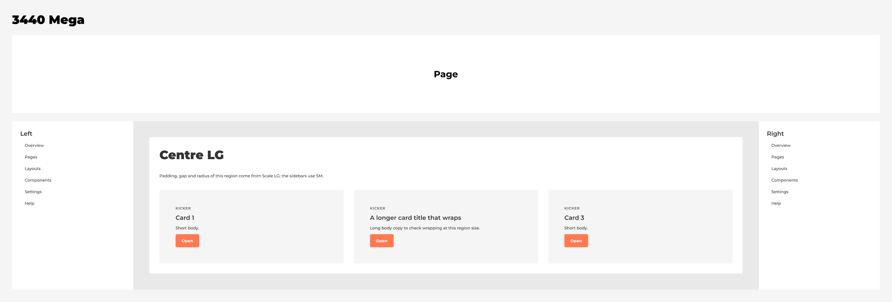

**What's on it:** a `Page master` instance (title "Page" centered) above a `Layout.ScaleRegions Set` instance: a 360 XS-ish `Left` nav rail, a `Centre LG` card region with 3 demo cards, and a `Right` nav rail mirroring the left one.

**Eye lands:** the "3440 Mega" title, top-left — but it's small relative to the frame, so the eye then drifts into the large empty band below it before reaching "Page".

**Problems (this is the clearest live example of build-checklist issue #5, "text doesn't scale"):**
- The `Page master`'s title band is the full 3440 width but the "Page" text is centred and tiny next to all that width — roughly 80% of that band is empty gray/white.
- Both `Left` and `Right` nav rails are narrow (~270 px of menu) inside a much taller, wider available column, leaving a large flat void below each rail's last link ("Help").
- The white `Centre LG` card itself floats inside a wider gray region with visible voids left and right of it.

**Fix:** same direction as build-checklist's existing note — either give text a Scale-mode-driven size, or treat the 3440 root more like the 2600 XL page's organised frame (explicit sections with their own content, not one shared demo stretched across the full width).

## Elements

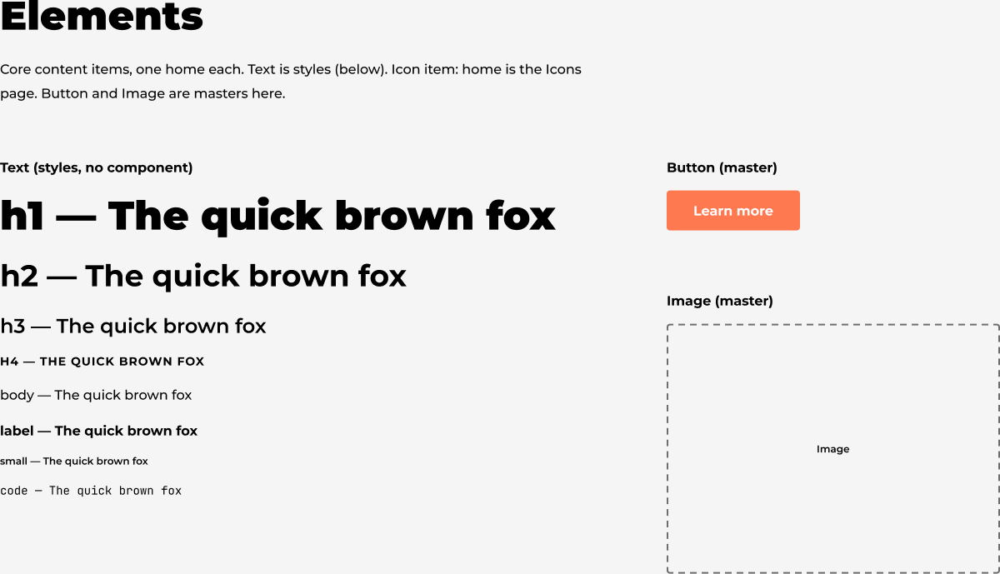

**What's on it:** the "Elements" reference page — all 8 text styles (h1–code) in one column, a `Button` master ("Learn more"), and an `Image` master placeholder, two-column layout (text left, Button/Image right).

**Eye lands:** "Elements" H1, then "Text (styles, no component)".

**Problems:** none. Good hierarchy, clean two-column split, no voids given it's a small reference page.

## Icons

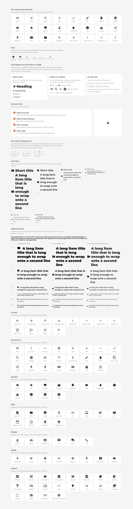

**What's on it:** the full icon library — "The icons you'll use most" (16 core icons), "Icon" (single square icon spec, swap instructions, mode-on-parent and web-usage notes), "Swap an icon" (4-step walkthrough with a live star example), "Icon with a background", "Icon item" (name + icon row, with alignment tests at H1–H4 and three alignment recommendations A/B/C), then category rows: Arrows, Menus & UI, Generic, Files, People, Media, Layout — each a consistent icon-plus-label grid.

**Eye lands:** "Icons" H1, then the first icon grid.

**Problems:** none found. Dense but consistently gridded, clear section headers throughout, no overlaps.

## Scale

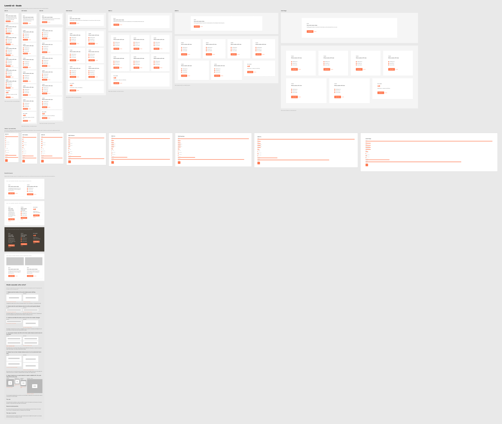

**What's on it:** "Lew42 v2 · Scale" — a row of 7 size samples (one card at each Scale width, 360 XS through 3440 Mega, each growing), a "Tokens · by mode (live)" bar-chart row (one bar per token per mode, so it can't go stale), and an "Essential layouts" section with a mode-cascade explainer (6 numbered test cases: which mode wins when header/card/instance disagree) plus dark and image-placeholder variants.

**Eye lands:** "Lew42 v2 · Scale" title, then the row of 7 growing cards.

**Problems:** same family as 3440 Mega — the 2600 XL and 3440 Mega sample cards in the top row are visually small relative to how much wider their columns are than the smaller sizes'. Not a defect in this reference page itself (it's explicitly a size comparison), but it is live, visual evidence for the "text doesn't scale" issue logged against 3440 Mega above.

## Squeeze

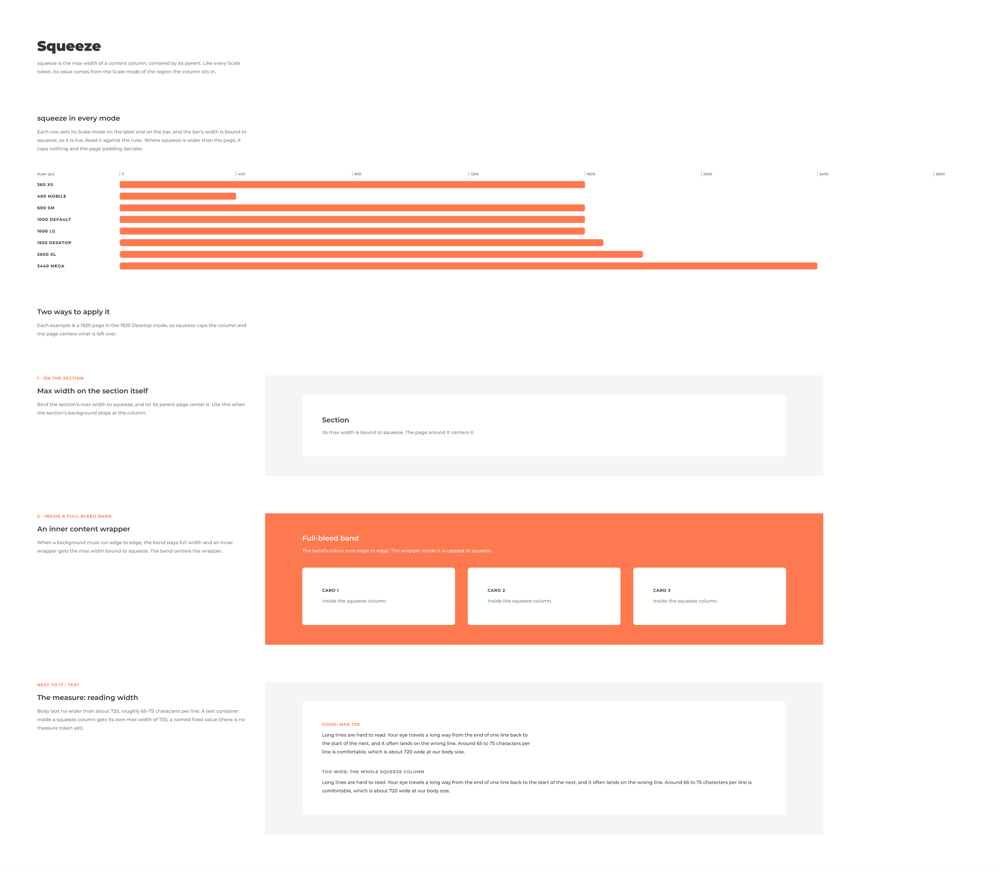

**What's on it:** explains the `squeeze` token (max content width per Scale mode) with a live truth-table of bars (one per mode, bound to the real token so it can't drift), then "Two ways to apply it" (max-width on a section vs. an inner wrapper inside a full-bleed band, each with a live example), then "The measure: reading width" (a good-vs-too-wide body-text comparison).

**Eye lands:** "Squeeze" H1, then the live ruler/bar chart.

**Problems:** none. Clear structure, live-bound diagrams (can't go stale), good vs. bad comparison is easy to scan.

## Explore – Sizing

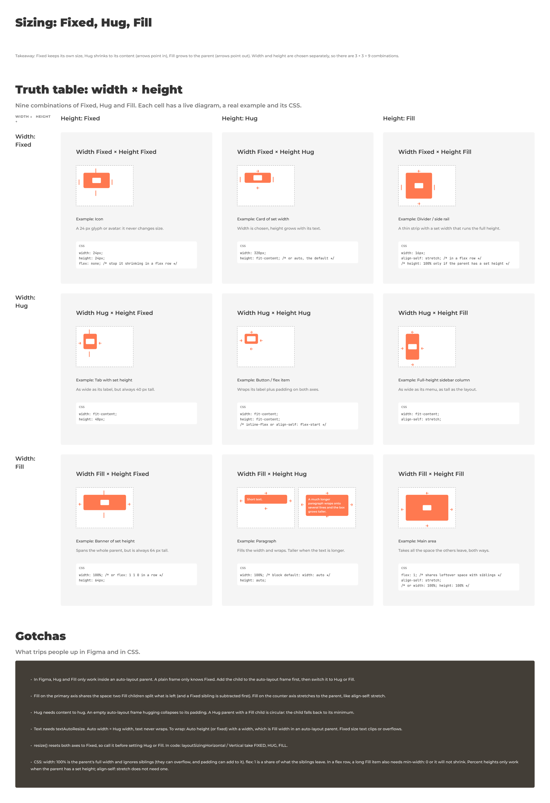

**What's on it:** "Sizing: Fixed, Hug, Fill" — one 3×3 truth table (width × height combinations), each cell a live diagram + a named example + its CSS, then a dark "Gotchas" card with 6 bullet points on Figma/CSS mismatches.

**Eye lands:** the H1, then the 3×3 grid's column/row headers.

**Problems:** none. This is one of the strongest reference pages in the file — consistent cell structure, real CSS beside every diagram, a clearly separated gotchas block.

## Explore – Color permutations

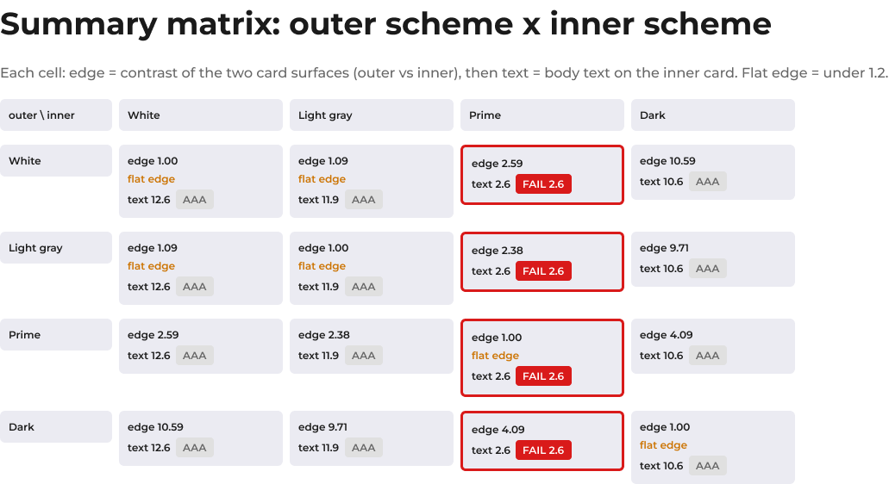
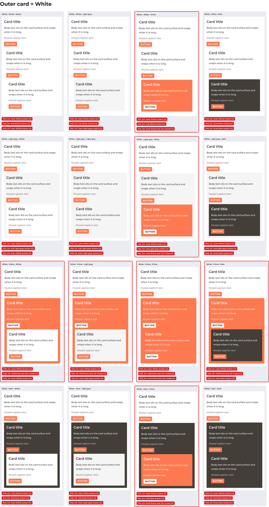

**What's on it:** a `Card Set` master (left of the board) covering Scheme × Overlay; the board itself has a Header, a "Summary matrix: outer scheme × inner scheme" (4×4 grid of real computed contrast numbers), a "Nested section" of 4 stacked groups — one per outer scheme (White, Light gray, Prime, Dark) — each showing 4 inner-scheme pairings × 4 nesting depths, an "Overlay section", and a "Long text section" (not screenshotted this pass).

**Eye lands:** "Summary matrix" heading, then the red-outlined Prime column.

**Problems — these are real, not display artifacts (see "The two biggest problems" above):**
- Every card in the "Outer card = White" group (and, by the summary matrix, every other outer/inner pairing too) carries a `FAIL 2.6` pill under its button, meaning the button's white label text on the orange accent fails WCAG AA (4.5) everywhere.
- The Prime column of the summary matrix additionally fails body/muted text contrast (2.6) against all four outer schemes.

**Fix:** this is a token-level fix (Button `on-accent` colour or the accent itself), not a per-page fix — see the top of this doc.

## Explore – Icon + title

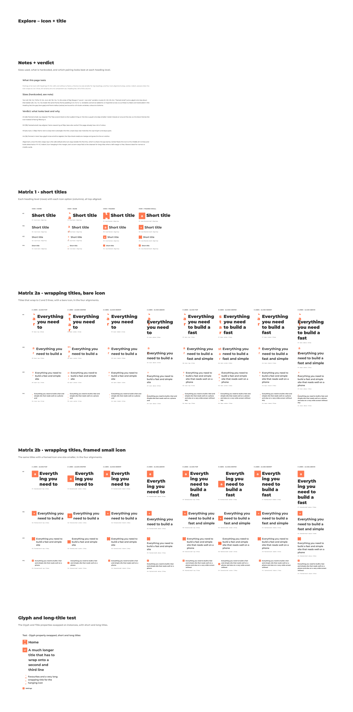

**What's on it:** "Notes + verdict" (what the page tests, hardcoded sizes, and a written verdict per heading level: H1/H2 → framed-small top-aligned, H3 → bare, H4 → framed; alignment verdict: top is the safe default, indent best for long titles, above best for narrow/mobile), then "Matrix 1" (short titles × 4 icon options × 4 heading levels), "Matrix 2a" and "2b" (titles that wrap to 2–3 lines × 4 alignments × 4 heading levels, bare vs. framed-small icon), then a glyph/long-title swap test.

**Eye lands:** the H1, then the "Notes + verdict" heading.

**Problems:** none found. The verdict text itself already identifies the best combination at each heading level, and the matrices back it up visually — every cell lines up, no overlapping icon/text pairs.

## Explore – Figma → CSS

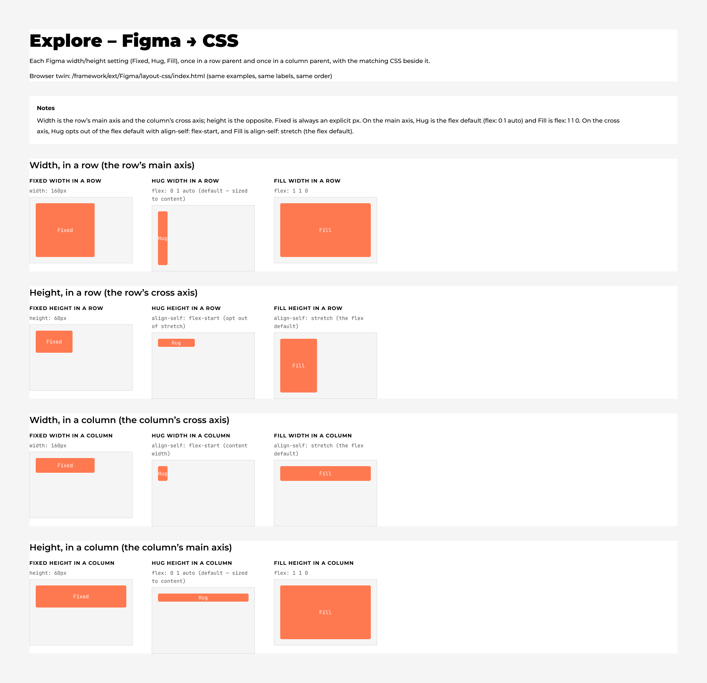

**What's on it:** "Explore – Figma → CSS" with a browser-twin link, a Notes card (main axis vs. cross axis in a row vs. column), then 4 sections (Width in a row, Height in a row, Width in a column, Height in a column), each a 3-panel Fixed/Hug/Fill comparison with the matching CSS property printed under each.

**Eye lands:** the H1, then the Notes card.

**Problems:** none. Each of the 4 sections leaves one grid slot empty (only 3 of 4 columns used), which is a minor void but consistent and clearly intentional (room for a 4th comparison that doesn't exist, e.g. no "Fixed-and-Hug" combo).

## Explore – Legacy vs Latest

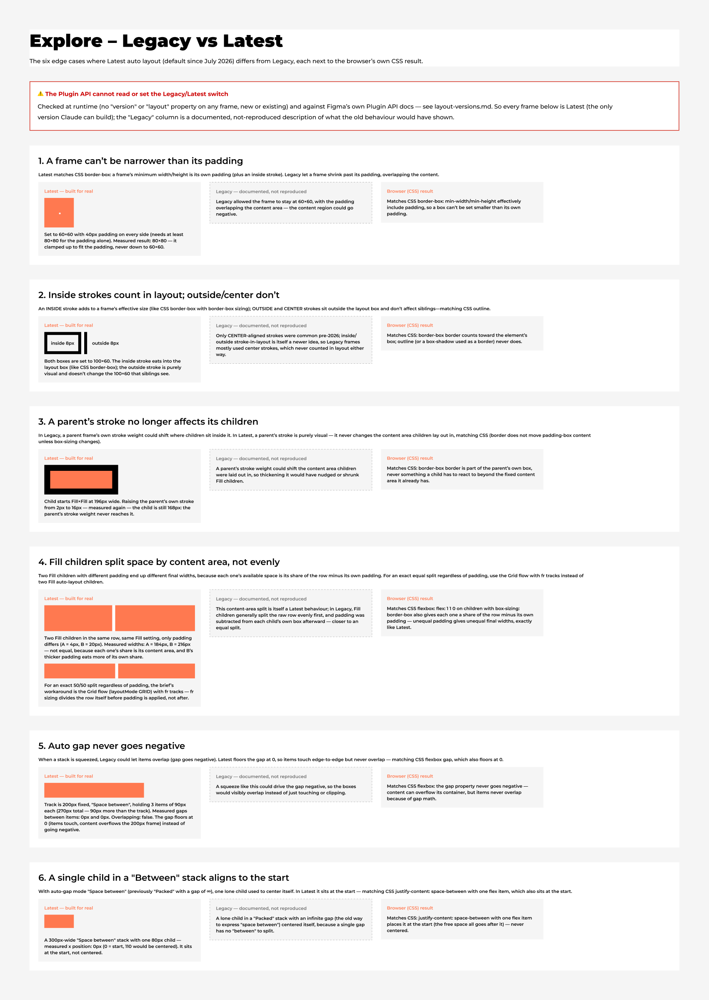

**What's on it:** a red warning card up top (the Plugin API can't read or set the Legacy/Latest switch, so every example below is Latest, not reproduced old behaviour), then 6 numbered rows (padding floor, inside vs. outside strokes, parent stroke, Fill-child space-splitting, auto-gap floor, single-child "Between" alignment), each row 3 cards: Latest (built for real, with a measured number), Legacy (documented, not reproduced), Browser/CSS result.

**Eye lands:** the warning card, then "1. A frame can't be narrower than its padding".

**Problems:** none. Honest about what it can't verify (the warning card), each claim backed by a measured number, consistent 3-card row pattern throughout.

## Explore – Drag playground

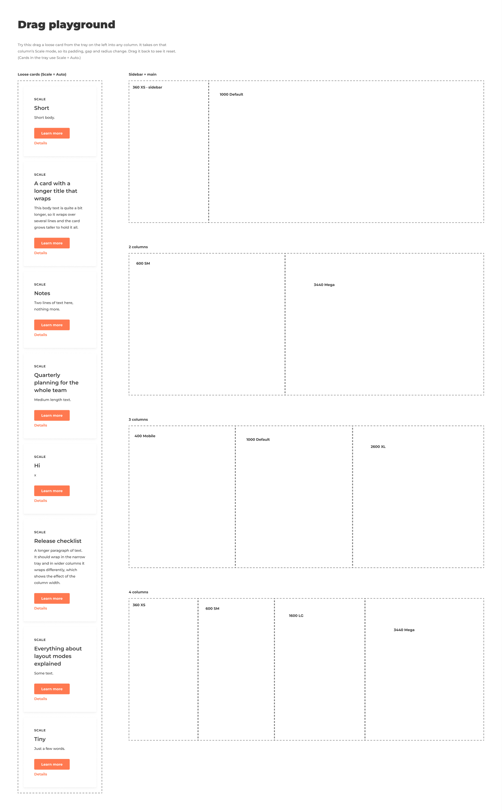

**What's on it:** a tray of 8 loose demo cards (Scale = Auto) on the left, and 4 empty dashed-outline drop targets on the right (Sidebar + main, 2 columns, 3 columns, 4 columns), each column labelled with which Scale mode it will apply to a dropped card.

**Eye lands:** "Drag playground" title, then the "What to try" instructions.

**Problems:** none — the large empty dashed regions are the intended starting state of an interactive drag demo, not a layout defect.

## 2600 XL (audited last)

Landed its second pass before this audit started (Brief C). Reusing the existing before/after/section screenshots from that pass rather than re-shooting a page that just changed.

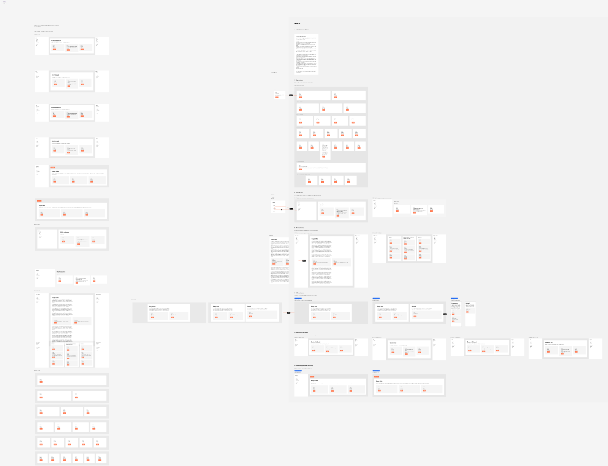

**What's on it:** the "Explore – 2600 layouts" organised frame (sections 1–6: single column grids, two columns card-style/flush, three columns with a page card or inner columns, Miller columns desktop + mobile, Scale-mode-per-region, sidebar toggle with Smart Animate), with every master (Card, Nav item, Sidebar, Page card, the 5 `Layout.*` Sets) parked loose on the canvas, each with a short labelled arrow to the first section that uses it.

**Eye lands:** the "2600 XL" title and notes frame (top-left of the organised frame).

**Problems:** none found in sections 1–6 (spot-checked section 2 and section 5 individually — both clean: consistent card grids, correct Fill-height sidebars, no clipped or overlapping text).

**The parked-masters overlap question:** checked the five `Layout.*` Set frames' own node geometry (not just the screenshot, which downscales this region too much to judge by eye):

| Set | y start | y end (start + height) | Gap to next |
|---|---|---|---|
| `Layout.ScaleRegions Set` | 671 | 5,027 | 160 |
| `Layout.Sidebar Set` | 5,187 | 7,227 | 160 |
| `Layout.Columns.Two Set` | 7,387 | 9,555 | 160 |
| `Layout.Columns.Three Set` | 9,715 | 12,383 | 160 |
| `Layout.Columns.One Set` | 12,543 | 15,855 | — |

**No overlap.** Each Set's own bounding box ends with a clean, identical 160 px gap before the next one starts — the visual effect in the downscaled whole-page screenshot (several "Centre Default / Centre LG" card pairs stacked close together) is each Set's own variants (e.g. `Layout.ScaleRegions Set` has 4: XS/Default, XS/LG, SM/Default, SM/LG) rendering as adjacent thumbnails inside one Set's frame, not two different Sets colliding.
