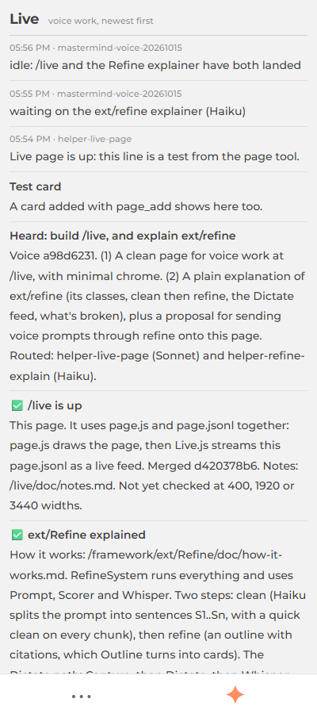

# Refine audit, 2026-10-15: the owner's rules, the lost sentence, the classes

Asked by the owner's voice session 6e9eb755 (brief: `ai/sessions/2026/10/15/voice-20261015/refine-audit/requirements.md`). Every claim was read from the source; `file:line` says where. How Refine works in general: [how-it-works.md](how-it-works.md). The compact redesign this audit leads to: [redesign.md](redesign.md).

**One-screen answer.**
- "No model" was a **plain function**, `quick_clean()`. A model clean also runs, one chunk at a time, but it is not what that label describes.
- The near-verbatim cleaning, the sentence chunking and the raw, clean, refined flow all exist, but chunking is only partly tunable and the **mention conversion does not exist**.
- Two real bugs found and fixed (the model's `S1.` numbering leaked into the text; the text box was clipped). One design bug found, not fixed: one `Prompt` is overwritten by every auto-sent sentence, which is the most likely way "Can you hear me?" vanished.

---

## 1. The owner's rules, checked

| Rule | Verdict | Where, in one sentence |
|---|---|---|
| Clean is near-verbatim: capitalize, drop fillers, upgrade references only when sure, nothing else removed | **present** | The model prompt says "Stay as close to verbatim as possible… Fix ONLY" typos when certain, capitals, punctuation, fillers and stutters (`Servex/agents/tidy.js:23-33`); a faithfulness check throws away any sentence that adds words not in the raw (`Cleaner.js:136-178`, moved from `engine.js` the same day); the instant clean does the same with a plain filler list (`Cleaner.js:233-249`). |
| Chunks go to the model a sentence (or clause) at a time, never word by word, because Whisper amends itself | **partial** | Whisper only sends a *finished* segment (a 700 ms pause, `Dictate.js:751`) to the clean step; the growing guess is shown but never cleaned (`Dictate.js:466-468`), and live refine waits for finished sentences, holding the last one back (`LiveRefine.js` `finished = … parsed.length - 1`). But the clean call is per *segment* (a pause), not per sentence, and the real per-sentence clean (`LiveClean.js`) is **opt-in and unused by default**. |
| The flow is raw, then clean, then refined | **present, hidden in the demo** | The stages exist and are logged in that order per prompt (`prompts.jsonl`: `raw`, `clean`, `refined`, `notes`). But the Refine page draws `Prompt.View` with `show_raw: false` (`RefineDemo.js:151`), so the "1 · Said" stage is only the text box; the owner never sees three stages side by side. |
| Chunking is configurable with a good default | **partial** | The mic knobs live in `SETTINGS` and a gear panel (`ext/Chat/Mic.js:9-22`: send mode, pause lengths, safety chunk) with defaults. The refine side is hard-coded constants (`MIN_BATCH 3`, `MAX_WAIT_MS 6000`, `MAX_BATCH 12`, `LiveRefine.js:31-33`), not tunable from the page. |
| Mentions: a control character (`@`, `/`, `!`) plus a path becomes a linked block; cleaning may convert text into those | **missing** | `ext/Mention` only turns `#Page` and `@owner` into a link, from two name maps, at render time (`ext/Mention/readme.md`); it knows no `/path` or `!` form. Neither clean step (`Cleaner.js`, `tidy.js`, `LiveRefine.js`) calls it or produces a mention; the only trace is the word "Mention" in the spelling glossary (`Cleaner.js:11`). |
| Is "clean" a model or a plain function? The page said "no model" | **both, and the label is right** | The words "instant, N ms, no model" come from `Prompt.View` (`Prompt.js:161`) and describe `quick_clean()`, a plain function with a filler list (`Cleaner.js:237-241`) that fills the Cleaned column on every keystroke or chunk (`RefineSystem.quick`, `RefineSystem.js:105`). The model clean (Sonnet by default, `tidy.js:21`) runs separately: once per dictated chunk in the chat box (`Revise.run`), and once over the whole prompt on Refine (`Cleaner.js:207`, Haiku). |

---

## 2. Bugs

### Fixed

**The model's `S1.` numbering leaked into the text** (`ux/Revise/Revise.js`).
- Cause: since 2026-10-02 the clean prompt makes the model number its sentences ("S1. …", `tidy.js:33`) so Refine can cite them. `Revise.run()` hands that reply straight back, and the chat box puts it into the text. Checked live: `POST /api/tidy {"text":"can you hear me","level":"clean"}` returns `S1. Can you hear me?`.
- Seen in the owner's own dictation, session `e5090ce3` (`prompts.jsonl` rows 8 and 20): raw text containing `S1. … S2. … S1. …`, a restart at S1 for every chunk, and a bare `S2.` landing as a "sentence" of its own in the clean list (row 10).
- Fix: `Revise.run()` now strips the markers and the `unclear:` note for the clean level (`Revise.plain()`). Client-side only, so Servex needs no restart; `engine.js` still reads the numbered form, which it needs.

**The text area clipped.**
- Cause: `Prompt.css` sets `.refine-toolbar textarea { block-size: 3.4em; min-height: 0 }` in the `site` layer. It beats the composer's own one-line-grows-to-three rule (`Chat.css:102`, in the weaker `theme` layer) and the box's `field-sizing: content`, so a 400 px phone shows a two-line placeholder cut off half way (screenshot in section 4).
- Fix: those override lines are removed so the one composer rule decides the height.

### Found, not fixed

**"Can you hear me?" vanished from the cleaned text. Most likely cause (read from the code, not reproduced on a live mic):**
- The page has **one** `Prompt`. The chat mic auto-sends after a 700 ms pause (`Mic.js` `paragraph_pause_ms`), each send calls `system.go(text)` (`RefineDemo.js:71-77`), which takes the model ~8 s.
- Meanwhile the owner keeps talking; the next input event calls `system.quick(text)` with **only the new words** (the box was emptied by the send) and overwrites `prompt.raw` and `prompt.clean` (`RefineSystem.js:105-111`). The first sentence is gone from the Cleaned list.
- When the older call returns, `prompt.load(out)` (`RefineSystem.js:128`) overwrites again, so the Cleaned column always shows whichever call finished last, never the whole transcription. After a send finishes (`status "done"`), `quick()` returns at once (`RefineSystem.js:108`) so new words are not shown at all until the next send.
- Why not fixed now: the fix is not a one-liner. It needs one transcript that accumulates sentences (a list that outlives each `Prompt`), which is the core of [redesign.md](redesign.md). A quick guard would just hide the new words instead of the old ones.

**Other ways a first sentence can go missing (lower likelihood, each checked):**
- A very short segment is never sent to Whisper: less than 120 ms of speech above the floor is skipped as silence (`Dictate.js:517-523`, `min_speech_ms`). A soft one-word opener can fall under it.
- A failed Whisper request ends the dictation with an error and the audio is already cut, so that sentence is **not retried** (`Dictate.js:489-499`).
- Whisper can double a phrase; the dedupe collapses a repeat (`Mic.js:616`, `same_as_last_send`). The owner's log shows "Testing, can you hear me? Testing, can you hear me?" (`prompts.jsonl` row 2): a doubled sentence, not a lost one, but it shows the dedupe does not catch every case.
- The sequence guard (`seq <= applied_seq`, `Dictate.js:466,502`) only drops answers for an **older** segment; read through, it cannot drop the first reply (the first request is `seq 1`, `applied_seq` starts 0).

---

## 3. Which classes handle what, and what is documented

| Job | Classes (file) | Documented | Missing |
|---|---|---|---|
| **Mic** | `Capture` (`ux/Dictate/capture.js:18`) opens the mic at 16 kHz, cuts WAV chunks; `Dictate` (`ux/Dictate/Dictate.js`) runs the state machine; `ComposerMic extends Dictate` (`ext/Chat/Mic.js:108`) puts words in a box and sends them | `ux/Dictate/doc/architecture.md`, `ext/Chat/doc/mic-notes.md` | One page that shows the whole mic chain as one picture, and the live instance |
| **Local Whisper, incl. the dropped connection** | `Whisper` (`audio/Whisper/Whisper.js:19`), `WhisperSession` (`WhisperSession.js:24`), `Connection` (`ux/Dictate/Connection.js:22`) and `VoiceStrip` draw its health; `shared_detect_engine` (`Dictate.js:75`) | `ux/Dictate/doc/whisper.md`, `whisper-log.md`, [how-it-works.md §4](how-it-works.md) | A **segment lost to a dropped connection is not retried** and nothing says so (`Dictate.js:489-499`); the error text says "press 🎤 again" |
| **Cleaning** | `Cleaner` (`Cleaner.js`; `engine.js` keeps the old `quick_clean()` / `clean()` names), `Revise` (`ux/Revise/Revise.js:76`) for the chat box, `tidy()` (`Servex/agents/tidy.js:76`) behind `POST /api/tidy`, `LiveClean`, `LiveRefine` (Servex) | `doc/refine-engine.md`, `doc/live-refine-2026-10-12.md` | The two clean paths (chat box per chunk, Refine whole prompt) are not told apart anywhere; the `S1.` contract between `tidy.js` and its callers is undocumented (that is the bug above) |
| **Refinement** | `structure()` (`structure.js`), `Outline`, `Prompt`, `Scorer`, `RefineSystem`, `LiveRefine` | `doc/architecture.md`, `doc/prompt.md`, [how-it-works.md](how-it-works.md) | `Cleaner` is now a class (`Cleaner.js`, class page [cleaner/](/framework/ext/Refine/cleaner/)); `Structurer` is still only a name in the design note, `structure()` a function. **Mentions are not wired in at all** |

Smallest gap to close: a mention rule for cleaned text (the owner's `@` `/` `!` rule). It is listed in [redesign.md](redesign.md) as a later step, not built.

---

## 3b. Answers to the second batch of owner notes (voice a7df214f, 29c40ff7)

**More on the dropped first sentence, now reproduced in code.** `strip_words(text, sent)` (`ext/Chat/Mic.js:77-104`) removes the words of already-sent text from the front of a new segment, and it matches fuzzily: all of `text` against the front of `sent` counts too. Run in node: `strip_words("Can you hear me?", "Testing, can you hear me?")` returns `""`, and so does a plain repeat of the same sentence. `commit()` then returns early (`Mic.js:147-152`) and nothing is added. The second branch (`else if (this.dropped)`, `Mic.js:149`) has no check that `dropped` belongs to this segment, unlike the other uses (`:132`, `:166`), so a `dropped` left over from an earlier send can swallow a later, different segment. Not fixed here: the dedupe is what stops a sent guess being posted twice, and loosening it needs a live-mic test.

**What triggers Refine now.** Two things start it, and no model decides when:
- The **Refine** button (`RefineDemo.js:46`, `go()` at `:128`): stops the mic, takes the box text, runs `system.go()` (clean, then outline, then scores).
- The mic's **auto-send** after a 700 ms pause (`RefineDemo.js:71-77`) calls the same `go()`.
- While you talk, `ComposerMic` also posts the growing text to the live refine (`Mic.js:223`, `:236`, `RefineSystem.post_live`). The server decides when to call the model by a plain rule: wait for 3 new sentences or 6 s, never more than 12 per call (`LiveRefine.js:31-33`). So auto-refine exists, paced by counts and time; an "LLM decides when" trigger does not.

**Plain terms.**
| Name | What it is | AI? |
|---|---|---|
| `structure()` (`structure.js:58`) | asks a model to group the clean sentences into an outline, each card citing its sentences (`[S1, S3]`) | **yes**, a model call |
| `Outline` (`Outline.js`) | reads that outline text into nested cards | no, a plain parser |
| `Scorer` (`Scorer.js:6`) | gives each sentence a clarity and weight from fixed rules (starts at 0.5, moves on evidence) | no, rules only |
| `Cleaner` | clean the words: `quick_clean` is a plain function, `clean` is a model call plus a plain check | both |

**Default page padding.** Set once, in `core/Page/Page.css`: `padding: var(--page-pad, var(--pad-y) var(--gutter-x))` (`:186`), where `--gutter-x: clamp(2em, 4%, 5em)` (`:173`, the sides) and `--pad-y: clamp(1.5em, 4%, 3em)` (`:178`, top and bottom). A page opts out with `--page-pad` (for example `0`). The three spacing tokens `--pad`, `--gap`, `--flow` are separate (`framework.css:263-265`) and are for inside boxes, not the page edge. **Proposal, not applied** (it moves every page): make the page edge a single token from the same family, `--page-pad: var(--pad)` on all sides, `--pad = clamp(1em, 2.6% - 1.1em, 4em)`. That is about 16 px on a phone and 40 px on a desktop, one value that scales from a card to a page, instead of two different clamps (32 px sides and 24 px top at 400 wide). The Refine page already opts out (`.ac("wide")`) and would go edge to edge in [redesign.md](redesign.md).

**The "cleaner" link.** It was `/framework/ext/Refine/md/doc/refine-engine/`, the markdown child of the module, which opens a doc page and not the cleaner. `Cleaner` is now a real class, so the link is the new class page [`/framework/ext/Refine/cleaner/`](/framework/ext/Refine/cleaner/) (`Prompt.js` stage list, `RefineSystem.js` parts table).

**Cleaner as a class** (`ext/Refine/Cleaner.js`, one class per file). The code moved from `engine.js` by script, not retyped. `Cleaner` has `quick_clean(text)` and `async clean(text, opts)` as methods that remember their last run (`raw`, `sentences`, `mode`, `status`, `ms`, `flags`), plus static stateless forms. `engine.js` is now six lines of aliases (`clean`, `quick_clean`, `GLOSSARY`, `word_overlap_score`), so the roughly fifteen callers (Servex `run.js`, `LiveRefine`, `Echo`, the browser's `RefineSystem`) still import what they did. Two near-verbatim cautions seen while moving it: `quick_clean` collapses *any* immediate repeat (`"had had"`, `"very very"`), and it ends a chunk with `?` if the first word is a question word, so `"Can you hear me the mic is on"` becomes one question. Both are on the list in [redesign.md](redesign.md) as rules to tighten, not changed here.

---

## 4. Mobile screenshots (400 px wide)

**Refine, before the fixes** (taken from the main site before the merge; the textarea placeholder is cut off, and raw is not shown):

**/live/** at 400 wide:

The compact page these lead to is proposed in [redesign.md](redesign.md).
