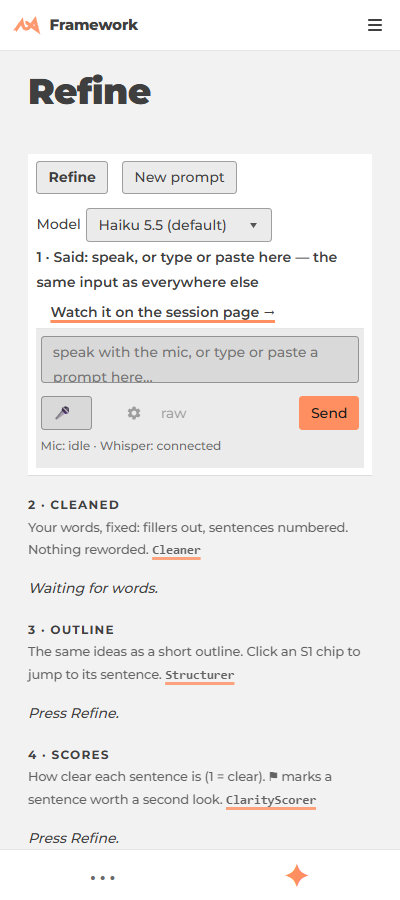

# Refine redesign: one compact page, raw then clean then refined (slice built 2026-10-16)

**Built 2026-10-16** ([task](/framework/ai/sessions/2026/10/16/voice-20261016/refine-build/)): steps 1, 2 and 4 below, plus the per-sentence flow: `RefineSystem` keeps one chunk per send so every sentence stays (`chunks`), the composer's `per_sentence` option sends each finished sentence out of the box while the next is still heard, and `test/composer-flow.mjs` proves it with a fake microphone. **Not done:** the page `h1` still sits above the toolbar (step 3), the stage titles are still "1 · Said / 2 · Cleaned / 3 · Outline / 4 · Scores", and a one-sentence utterance gets its live outline only about 8 s after the send. The rest of this page is the original proposal.

Asked by the owner's voice sessions 6e9eb755, a7df214f and 29c40ff7. Facts behind it: [audit-2026-10-15.md](audit-2026-10-15.md). What the page looks like today at phone width (400 px):



**What is wrong in that picture.** The page title and the toolbar take the first screen. The Said stage is a wordy caption ("speak, or type or paste here, the same input as everywhere else") over a box that clips its own placeholder. The raw text is not shown at all, so you cannot watch Whisper. Each stage carries a grey explanation and a class link. It reads like a custom template, not like the rest of the site.

---

## The one compact page

Mobile first, full width, edge to edge. Nothing explains itself; the stage name is the only label.

```
+--------------------------------------------------+
| Refine   [mic] [Refine] [New]        model  $0.02 |  toolbar: edge to edge, sticky, one row
+--------------------------------------------------+
| RAW (live, from Whisper)                          |  small, muted, grows as you speak
| um can you hear me the the mic is on              |
+--------------------------------------------------+
| CLEAN                                             |  one line per sentence, S1 S2 ...
| S1 Can you hear me?   S2 The mic is on.           |
+--------------------------------------------------+
| REFINED                                           |  cards; S-chips jump to a clean sentence
| > Mic check   [S1 S2]                             |
+--------------------------------------------------+
| mic: listening - whisper: connected               |  sticky footer, one line
+--------------------------------------------------+
```

At 1200 px and wider the three stages sit side by side with the same labels. The top row is the sticky mic card the owner already likes; only its words go.

**Rules for the page (from the owner's notes):**
- One small title inside the toolbar, not an `h1` above it (no wasted first screen).
- Toolbar and footer run edge to edge (`bleed`, `core/Page/Page.css`), so the page padding does not apply to them.
- The sticky mic card stays. Its caption line "speak, or type or paste here, the same input as everywhere else" goes, and so does every other explanatory sentence on the page. A stage keeps its label and nothing else.
- **Raw stays visible and live**, so you watch Whisper amend itself. It is the same Whisper text the box already holds; it just gets a visible, muted band.
- Clean is condensed: sentences only, flags as a small marker, the timing as one grey figure.
- The same three bands everywhere (the page, the chat, the session page), because they are one component.

---

## What changes, class by class

One of everything: nothing new is built from scratch. Each row is an existing class.

| Class | Change |
|---|---|
| `RefineDemo` (`RefineDemo.js:34`) | draw `Prompt.View` with `show_raw: true`; drop the "1 · Said" caption and the session-page link text (an icon instead); add `bleed` to the toolbar and footer |
| `Prompt.View` (`Prompt.js:125`) | a `compact` flag: stage title only, no `what` line, no class link; same view on every surface, so one flag fixes all of them |
| `Cleaner` (`Cleaner.js`) | no change to the page; its instance is what the band reads. Tighten two rules separately: stutter collapse should not remove real repeats ("had had"), and `quick_clean` should not turn a whole chunk into a question |
| `RefineSystem` (`RefineSystem.js`) | keep **one transcript** that gains a sentence per utterance, instead of one `Prompt` overwritten by each auto-send (the dropped-first-sentence cause in the audit). A finished `go()` result is merged in by sentence number, never replacing |
| `ComposerMic` (`ext/Chat/Mic.js`) | unchanged; its `strip_words` dedupe needs a live-mic test before it is touched |
| `Page` (`core/Page/Page.css:186`) | proposal only, see below |

**Page padding, one value.** Today the page edge is two clamps (`--gutter-x` for the sides, `--pad-y` for top and bottom, `Page.css:173,178`) while everything inside a box uses `--pad`. Proposal: the page edge becomes `--pad`, so a small card and a full page scale from the same one knob. This changes every page and is **not applied**; it needs your yes.

---

## The smallest slice

Each step is one commit, and each can be viewed alone.

1. `show_raw: true` and a `compact` flag on `Prompt.View` (drops stage captions). One page, two small edits.
2. Remove the Said caption line and the "Watch it on the session page" sentence in `RefineDemo.js`; keep an icon link.
3. Toolbar and footer `bleed`; the title moves into the toolbar row.
4. Accumulate utterances in `RefineSystem` (the fix for the vanishing first sentence). This is the only step with risk; it comes last and gets a live-mic test.

**Not in the slice (still true):** mentions (`@`, `/`, `!` plus a path becoming a linked block; today nothing produces them, see the audit), a per-sentence clean call, and the page padding change.
