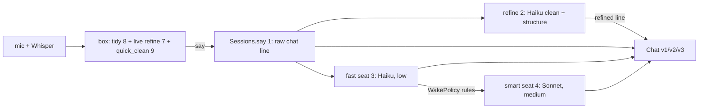

# Background work on a spoken sentence — every job, what it costs, who reads it

**What this is:** when you dictate, several things run behind the box without you asking. This page lists each one, what starts it, which model, what it writes and who reads it. Built 2026-11-01 (the owner's ask: "there's all kinds of different things happening"). Facts come from a read of the code (Haiku readers, then Sonnet re-checking each claim by grep), not from memory. For where each *piece* lives, see [map.md](map.md); for the completed tasks, [ai/doc/built-index.md](/framework/ai/doc/built-index.md).

## The one-sentence answer

A dictated sentence, once it reaches a voice session, gets: **(1)** a raw `{chat}` line, **(2)** a Haiku *refinement* (clean, then structure) for any line of 2+ sentences or 15+ words, **(3)** the fast assistant woken (Haiku, low), **(4)** the smart assistant woken on a rule (Sonnet, medium). There is **one long-lived agent per seat per session**, reused: no fresh agent per prompt. The refinement, however, is a separate model call per line.

## The table

| # | Job | Where | Trigger | Model, effort | Writes | Read by |
|---|---|---|---|---|---|---|
| 1 | Raw line | `Sessions.say()` Sessions.js:1032 | a finished sentence arrives | none | `{chat}` into the session's `session.jsonl` | `ext/Chat` v1, v2, v3 |
| 2 | **Refinement** (clean, then structure) | `Sessions.refine()` :702, gated by `worth_refining()` :100 | every `say()` (:1059), not awaited | Haiku, via `Echo.call` | `{refined:{sentences,sections,flags,cost_usd}}` | `ext/Chat/Chat.js`, `ChatV2.js`, `ux/Dictate/chat.js` |
| 3 | Fast seat (voice-assistant, or session-fast with the item tool off) | `Sessions.spawn()` :1333 / :1342, woken by `wake()` :1388 | thought released after a quiet gap | Haiku, low | `{place}` (voice-assistant, via the item tool) or `{chat}`, `{skip}`, `{para}` | Chat v1/v2/v3, `ChatWriter.place` |
| 4 | Smart seat (session-smart) | `Sessions.spawn()` :1353, `WakePolicy.js` | any of: pause of `gap_ms` (12 s), a "?" ending, the word "smart"/"mastermind", N sentences piled up, mic off, a ❓ reaction | Sonnet, medium | `{chat}`, `{react}`, `{task}`, `{question}` | Chat, task views |
| 5 | Sent mark | `mark_sent()` :664 | each hand-off to a seat | none | `{sent}` with `delay_ms` | `ux/Dictate/Widget.js` (shown beside each line) |
| 6 | Idle sweeper | Sessions.js:353 | `setInterval` | none | stop line / sleeps the agent | Sessions itself |
| 7 | Live refine in the browser | `RefineSystem.post_live` → Servex `/api/refine/live` (Servex.js:816) → `LiveRefine.js` | every chunk while you speak | Haiku | nothing on disk; streamed back | the composer (`ComposerMic.on_refine_live`) |
| 8 | Tidy a chunk | `Dictate.revise_chunk` → `Revise.run`; also `Cleaner.clean` → Servex `/api/tidy` (Servex.js:683) | each chunk | Haiku | nothing on disk | the chat box draft |
| 9 | Mechanical clean | `Cleaner.quick_clean` (Cleaner.js:288) | called from `LiveRefine.js:75`, `LiveClean.js:19`, `VoicePage.js:91`, `RefineSystem.rows` | none (rules) | nothing | the same callers |
| 10 | VS Code prompt refine | `Echo.run_refine` (`Servex/ext/refine/run.js`) | a prompt typed in a VS Code tab | Haiku | the session's page | the Refine landing page |
| 11 | Past-prompt refine queue | `Server/RefineQueue.mjs` | run by hand (`--days 7 --limit N`) | Haiku | `ext/Refine/queue/runs.jsonl`, `asks.jsonl`, a `RefinedCard` on the session page | `AISessionCoverage.js:38` (Coverage tab) |
| 12 | Prompt audit | `Server/PromptAudit.mjs` | by hand | Haiku (structure), Sonnet (review) | `prompt-audit.jsonl`, `prompt-review.jsonl` beside the session | no code reads them (docs only: [prompt-audit.md](/framework/ai/doc/prompt-audit.md)) |
| 13 | Refine ladder script | `Server/refine.mjs` | by hand on a text file | Haiku to Sonnet | files beside the input | a human |

## Flow

## Surprises

1. **Four refiners do the same job on the same sentence.** The in-session `refine()` (2), the browser `/api/refine/live` (7), the VS Code `Echo.run_refine` (10) and the queue (11) all clean and structure text through the shared Refine engine. Rows 2 and 7 both run on one spoken chunk. Rows 7 and 8 both call Haiku for a clean (`/api/refine/live` and `/api/tidy`); tidying the same words twice is the "cleaned twice" finding of [map.md](map.md).
2. **The in-session refinement costs far more than a Haiku clean should.** The 99 `refined` lines logged since 2026-10-20 carry `cost_usd` summing to **$28.3, about $0.29 each**. Echo.js's own comment (line 115) says `clean()` and `structure()` each start a full SDK session, so each line pays two session start-ups instead of two cheap calls. A direct `ask`-style call would likely be a tenth of that; unproven, worth measuring.
3. **Some written work has no reader in code.** The audit files (12) are read by nobody. `{sent}` (5) is read (`Widget.js` draws it), so it is not dead. The only other "runs, no reader" case is row 13, which a human runs.

Smart-seat cost: about $0.70–1.17 per wake in recent sessions (e.g. `chat-messages/session.jsonl`); the fast seat's cost is not logged separately, it rides in its parent session's total.

## How this was checked

Haiku readers produced draft tables; the claims kept here were re-verified by grep (file:line above). One reader claim was wrong and is not repeated: `quick_clean` *is* called outside demos (row 9). The cost figure in surprise 2 is computed by summing `cost_usd` on every `{refined}` line under `ai/sessions/2026/10/2*`, `10/3*` and `2026/11`.
